# BUKU MANUAL PENGGUNA

## Aplikasi Monitoring Anggaran

### CDK Wilayah Bojonegoro — Dinas Kehutanan Provinsi Jawa Timur

| Informasi | Keterangan |
|---|---|
| Nama aplikasi | Dashboard Monitoring Anggaran CDK Wilayah Bojonegoro |
| Pengguna | Admin/Bendahara, operator seksi (TU, RLPM, TKUK), pimpinan, dan publik |
| Versi dokumen | 1.0 |
| Tanggal | 17 November 2026 |
| Cakupan | Fitur utama: dashboard, master data, pagu, RAK, transaksi, SPJ, kuitansi, kas & bank, pengajuan GU/TU, transfer perjalanan dinas, dan ekspor laporan |

> Manual ini disusun untuk pengguna aplikasi, bukan untuk pengembang. Alur ditulis sesuai tombol dan menu yang tersedia pada aplikasi. Beberapa halaman memiliki hak akses berbeda; perhatikan bab **Peran dan Hak Akses**.

---

## Daftar Isi

1. [Pendahuluan](#1-pendahuluan)
2. [Dashboard](#2-dashboard)
3. [Master Data](#3-master-data)
4. [Pagu dan Riwayat Perubahan](#4-pagu-dan-riwayat-perubahan)
5. [Analisa Sisa Anggaran](#5-analisa-sisa-anggaran)
6. [Rencana Penyerapan](#6-rencana-penyerapan)
7. [RAK dan Rekap RAK](#7-rak-dan-rekap-rak)
8. [Transaksi (Admin)](#8-transaksi-admin)
9. [Transaksi Saya (Seksi)](#9-transaksi-saya-seksi)
10. [SPJ Perjalanan Dinas dan Lembar 2 SPPD](#10-spj-perjalanan-dinas-dan-lembar-2-sppd)
11. [Cetak Kuitansi dan Kalibrasi](#11-cetak-kuitansi-dan-kalibrasi)
12. [Kas dan Bank (UP/GU)](#12-kas-dan-bank-upgu)
13. [Pengajuan GU (SPJ)](#13-pengajuan-gu-spj)
14. [Pengajuan Tambah Uang (TU)](#14-pengajuan-tambah-uang-tu)
15. [Transfer Perjalanan Dinas](#15-transfer-perjalanan-dinas)
16. [Ringkasan Laporan dan Ekspor](#16-ringkasan-laporan-dan-ekspor)
17. [Alur Status dan Aturan Perhitungan](#17-alur-status-dan-aturan-perhitungan)
18. [Penanganan Masalah](#18-penanganan-masalah)
19. [Checklist Operasional](#19-checklist-operasional)
20. [Lampiran: Peta Menu dan URL](#20-lampiran-peta-menu-dan-url)

---

# 1. Pendahuluan

## 1.1 Tentang aplikasi

Aplikasi ini digunakan untuk memantau dan mengelola anggaran CDK Wilayah Bojonegoro, mulai dari data master, pagu, rencana anggaran kas (RAK), transaksi belanja, verifikasi, pencatatan kas dan bank, pengajuan GU/TU, transfer perjalanan dinas, sampai pencetakan dokumen seperti kuitansi, SPD, dan lembar 2 SPPD.

Fitur utama aplikasi:

- Dashboard serapan anggaran untuk admin, seksi, dan publik.
- Master data: seksi, program, kegiatan, sub kegiatan, dan rekening.
- Pagu, riwayat perubahan pagu (APBD/PAPBD/KOREKSI), dan laporan selisih.
- RAK bulanan dan rekap RAK.
- Analisa sisa anggaran.
- Rencana penyerapan per rekening.
- Input dan verifikasi transaksi.
- Input transaksi oleh seksi melalui Surat Tugas.
- Rincian biaya perjalanan dinas, SPD, dan lembar 2 SPPD.
- Cetak kuitansi ukuran NCR 215 x 165 mm beserta kalibrasi posisi cetak.
- Kas dan bank (UP/GU).
- Pengajuan GU (SPJ) dan LPJ.
- Pengajuan Tambah Uang (TU).
- Transfer perjalanan dinas dan ekspor transfer Bank Jatim.
- Ekspor laporan ke Excel/CSV.

## 1.2 Peran dan hak akses

| Peran | Akun | Halaman yang dapat diakses | Catatan |
|---|---|---|---|
| Admin / Bendahara | role `admin` | Seluruh menu admin: Transaksi, Kas & Bank, TU, GU, Transfer Perjalanan Dinas, Master Data, Pagu, Analisa Sisa Anggaran, Rencana Penyerapan, RAK, Rekap RAK, Kalibrasi, SPJ | Dapat memverifikasi transaksi, mengubah pagu, dan mengelola seluruh data |
| Seksi TU | role `tu` | Dashboard TU, Transaksi Saya, Cetak Kuitansi, Kalibrasi Kuitansi, Kalibrasi Lembar 2 | Hanya melihat dan mengajukan data seksinya |
| Seksi RLPM | role `rlpm` | Dashboard RLPM, Transaksi Saya, Cetak Kuitansi, Kalibrasi Kuitansi, Kalibrasi Lembar 2 | Hanya melihat dan mengajukan data seksinya |
| Seksi TKUK | role `tkuk` | Dashboard TKUK, Transaksi Saya, Cetak Kuitansi, Kalibrasi Kuitansi, Kalibrasi Lembar 2 | Hanya melihat dan mengajukan data seksinya |
| Publik / Tamu | tanpa login | Dashboard publik, Analisa Sisa Anggaran, beberapa ekspor laporan | Tidak dapat membuka data transaksi internal |

Aturan akses penting:

- Pengguna seksi yang membuka halaman admin akan diarahkan kembali ke **Transaksi Saya**.
- Setiap pengguna seksi hanya dapat membuka dashboard sesuai perannya. Misalnya akun `tu` tidak dapat membuka dashboard RLPM atau TKUK.
- Halaman **Dashboard**, **Analisa Sisa Anggaran**, dan beberapa ekspor dapat diakses tanpa login.
- Admin yang ingin melihat tampilan dashboard publik dapat menambahkan `?view=public` pada alamat dashboard.

## 1.3 Login dan logout

### Login

1. Buka alamat aplikasi di browser (Chrome, Edge, atau browser modern lainnya).
2. Masukkan **Nama pengguna** dan **Kata sandi**.
3. Klik **Masuk**.
4. Setelah berhasil:
   - Akun admin diarahkan ke **Dashboard Admin**.
   - Akun seksi diarahkan ke **Transaksi Saya**.
   - Akun seksi juga dapat membuka dashboard seksinya melalui menu **Dashboard**.

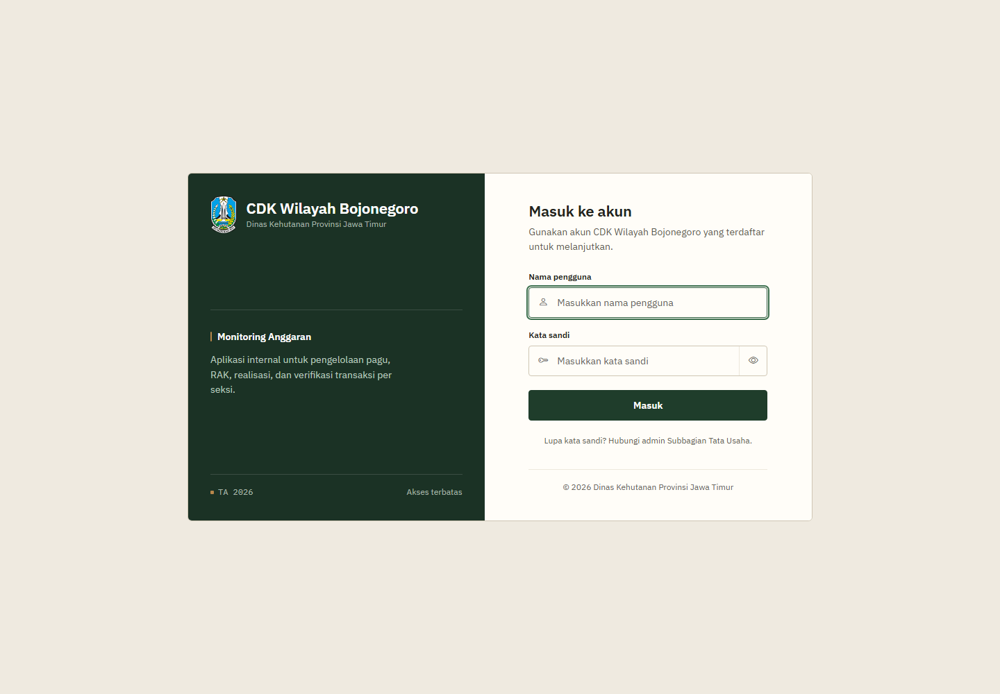

*Gambar 1.1 — Halaman login aplikasi.*

### Logout

1. Klik menu profil di pojok kanan atas.
2. Pilih **Logout**.
3. Selalu logout setelah selesai menggunakan komputer bersama.

> Kredensial akun diberikan oleh administrator sistem. Jangan membagikan akun dan kata sandi. Jika masih menggunakan kata sandi bawaan, mintalah administrator menggantinya sebelum aplikasi digunakan di lingkungan produksi.

## 1.4 Istilah dan singkatan

| Istilah | Arti |
|---|---|
| Pagu | Batas anggaran yang tersedia untuk suatu rekening pada tahun tertentu |
| PAPBD | Perubahan Anggaran Pendapatan dan Belanja Daerah |
| RAK | Rencana Anggaran Kas, yaitu rencana belanja per bulan |
| Realisasi | Nilai transaksi yang sudah berstatus terverifikasi |
| Komitmen | Total transaksi berstatus menunggu verifikasi ditambah terverifikasi |
| Sisa anggaran | Pagu dikurangi realisasi (pada dashboard dan analisa) |
| UP | Uang Persediaan |
| GU | Ganti Uang |
| TU | Tambah Uang |
| LS | Pembayaran langsung ke pihak ketiga |
| SPJ | Surat Pertanggungjawaban |
| SPD | Surat Perjalanan Dinas |
| SPPD | Surat Perintah Perjalanan Dinas |
| BKU | Buku Kas Umum |
| SP2D | Surat Perintah Pencairan Dana |
| Tagar RKA | Penanda kelompok belanja pada RKA SIPD, misalnya `#NBS4_AGRI_INDUSTRI` |
| Surat Tugas (ST) | Dokumen penugasan yang menjadi dasar transaksi perjalanan dinas dan SPJ |

## 1.5 Hierarki data anggaran

```
Seksi
  └── Sub Kegiatan
        └── Rekening
              ├── Pagu (anggaran per tahun)
              ├── RAK (rencana per bulan)
              ├── Rencana Penyerapan (rencana kegiatan)
              └── Transaksi (realisasi belanja)
Program
  └── Kegiatan
        └── Sub Kegiatan
```

Data master harus diisi berurutan: **Seksi → Program → Kegiatan → Sub Kegiatan → Rekening**, sebelum pagu, RAK, dan transaksi diinput.

---

# 2. Dashboard

## 2.1 Dashboard Admin

Dashboard admin adalah halaman utama setelah admin login. Halaman ini merangkum kondisi anggaran dan antrian pekerjaan.

Langkah penggunaan:

1. Buka menu **Dashboard**.
2. Pilih **Tahun** pada filter di bagian atas.
3. Periksa bagian **Antrian Verifikasi**. Daftar ini menampilkan transaksi yang menunggu verifikasi.
4. Klik **Lihat Semua** untuk membuka daftar transaksi lengkap dengan filter status.
5. Periksa kartu ringkasan:
   - **Serapan Anggaran**: persentase serapan, nilai realisasi, pagu, dan sisa.
   - **Kas & Bank (UP/GU)**: saldo kas riil, GU menunggu cair, belanja bulan ini, dan proyeksi kas.
   - **Status Transaksi**: jumlah transaksi menunggu verifikasi, terverifikasi, ditolak, dan total transaksi.
   - **Serapan per Seksi**: perbandingan serapan antar seksi.
   - **Aktivitas Terkini**: transaksi terbaru.
   - **Pending per Seksi**: jumlah transaksi yang belum diverifikasi per seksi.
   - **Tren Transaksi Bulanan**: grafik jumlah dan nilai transaksi per bulan.
6. Gunakan tombol **Verifikasi** atau **Tolak** pada antrian untuk memproses transaksi langsung dari dashboard bila diperlukan.

> Transaksi yang diverifikasi wajib memiliki **Tanggal Lunas Dibayar**. Nilai realisasi pada dashboard dihitung berdasarkan tanggal pembayaran/verifikasi, bukan tanggal transaksi.

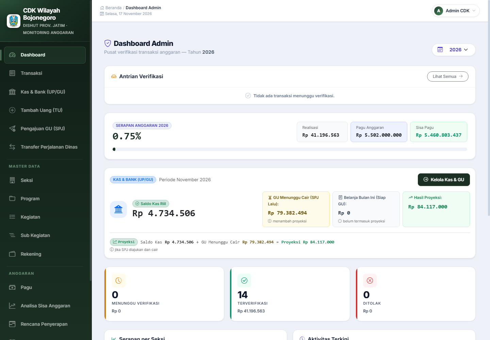

*Gambar 2.1 — Dashboard Admin: kartu serapan, antrian verifikasi, dan grafik.*

## 2.2 Dashboard publik

Dashboard publik dapat dibuka tanpa login dan digunakan untuk melihat kondisi serapan secara umum.

Langkah penggunaan:

1. Buka alamat aplikasi tanpa login, atau tambahkan `?view=public` bila sedang login sebagai admin.
2. Gunakan filter **Seksi**, **Program**, **Kegiatan**, dan **Sub Kegiatan**. Filter akan diterapkan otomatis.
3. Klik **Reset Filter** untuk kembali ke tampilan seluruh data.
4. Periksa kartu utama:
   - **Total Pagu**
   - **Realisasi** dalam persen sampai bulan berjalan
   - **Sisa Anggaran** (ditandai Over Budget bila negatif)
   - **Serapan vs RAK**
   - **Proyeksi Akhir Tahun**
5. Buka tab rincian:
   - **Serapan Bulanan**: realisasi per bulan.
   - **Sisa per Semester**: sisa semester 1 dan semester 2.
   - **Struktur Anggaran**: hierarki seksi, program, kegiatan, sub kegiatan, dan rekening.
   - **Tagar**: pagu dan realisasi per tagar RKA. Rekening tanpa tagar dikelompokkan sebagai `#PAD`.
   - **Deviasi RAK**: rekening yang realisasinya masih di bawah rencana RAK.
6. Gunakan tombol **Export Excel** untuk mengunduh laporan sesuai filter aktif.

> Realisasi dihitung dari transaksi berstatus terverifikasi. Transaksi yang masih menunggu verifikasi atau ditolak tidak mengurangi sisa anggaran pada dashboard publik.

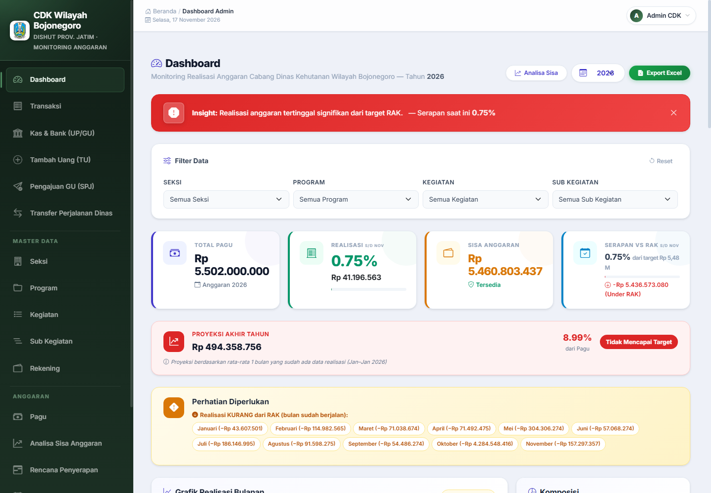

*Gambar 2.2 — Dashboard publik tanpa login, dilengkapi filter seksi dan program.*

## 2.3 Dashboard seksi

Setiap akun seksi memiliki dashboard sendiri:

| Peran | Alamat dashboard |
|---|---|
| TU | `/dashboard/tu` |
| RLPM | `/dashboard/rlpm` |
| TKUK | `/dashboard/tkuk` |

Dashboard seksi menampilkan:

- Total pagu seksinya.
- Total RAK seksinya.
- Realisasi dan persentase serapan.
- Sisa anggaran.
- Grafik realisasi bulanan dibandingkan RAK.

Data pada dashboard seksi hanya mencakup sub kegiatan dan transaksi milik seksi tersebut.

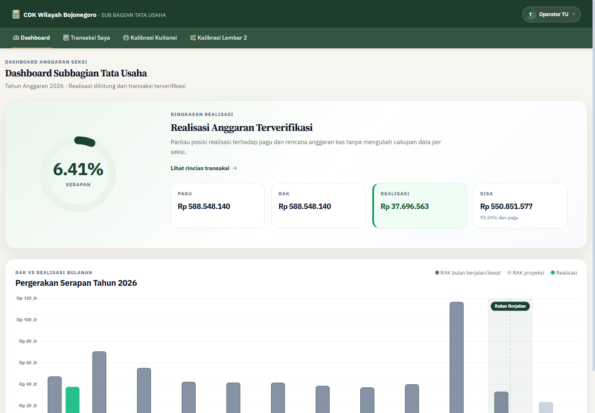

*Gambar 2.3 — Dashboard seksi dengan ringkasan pagu, RAK, realisasi, dan grafik bulanan.*

## 2.4 Ekspor laporan dari dashboard

1. Klik **Export Excel** pada header dashboard.
2. Pilih salah satu kategori:
   - **Laporan (format resmi)**:
     - Laporan Realisasi Anggaran
     - Serapan per Sub Kegiatan per Bulan
     - Serapan per Triwulan
     - Sisa Dana per Semester
     - RAK
   - **Tabel halaman ini**:
     - Detail Penyerapan per Bulan
     - Deviasi RAK
     - Ringkasan Serapan per Unit
     - Realisasi per Tagar
3. Laporan format resmi diunduh dari server dan mengikuti filter yang dipilih.
4. Ekspor tabel halaman dibuat dari data yang sedang tampil di layar. Pastikan filter sudah diterapkan sebelum mengekspor.

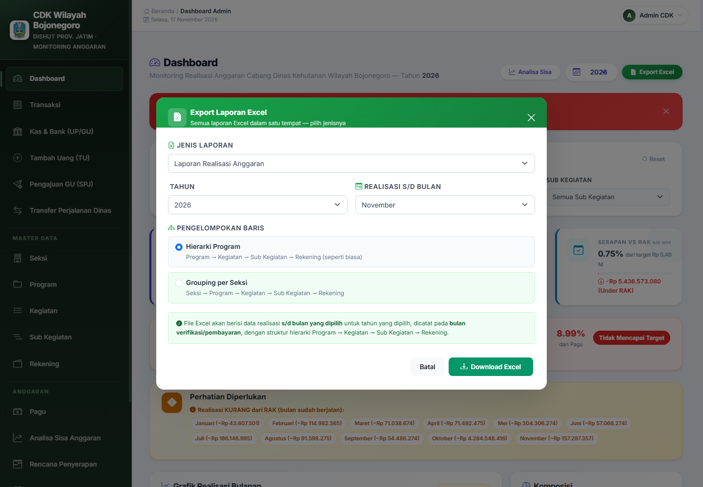

*Gambar 2.4 — Pilihan kategori laporan pada modal Export Excel.*

---

# 3. Master Data

## 3.1 Urutan pengisian

Isi master data dengan urutan berikut agar relasi antar data benar:

1. **Seksi**
2. **Program**
3. **Kegiatan**
4. **Sub Kegiatan**
5. **Rekening**

Setelah itu lanjutkan ke **Pagu**, **RAK**, dan **Transaksi**.

## 3.2 Seksi

Menu: **Seksi**

1. Klik **Tambah Seksi**.
2. Isi **Kode Seksi** dan **Nama Seksi**.
3. Klik **Simpan**.
4. Gunakan **Edit** untuk mengubah dan **Hapus** untuk menghapus data.

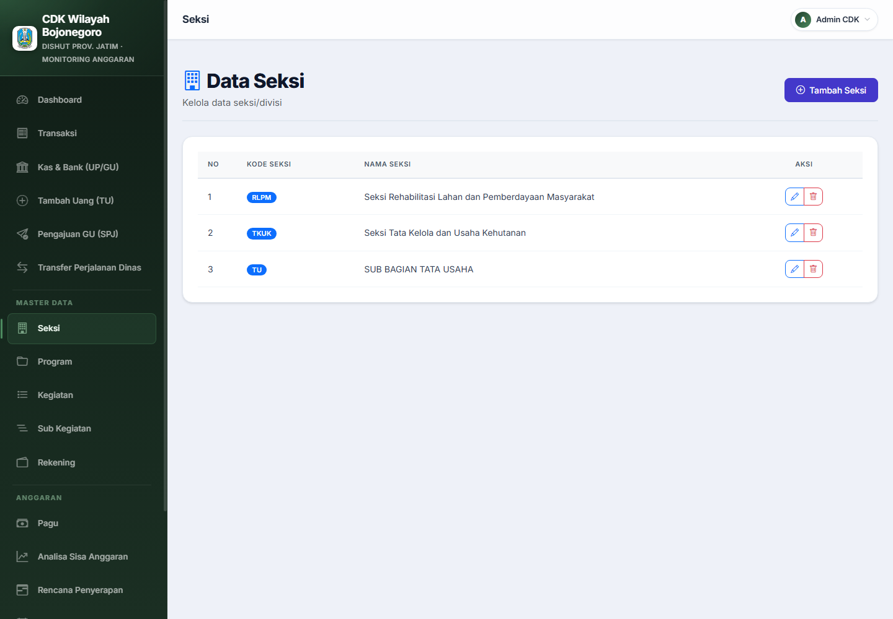

*Gambar 3.1 — Halaman master data Seksi.*

## 3.3 Program

Menu: **Program**

1. Klik **Tambah Program**.
2. Isi **Kode Program**, **Nama Program**, dan **Tahun**.
3. Klik **Simpan**.
4. Satu program digunakan sebagai induk kegiatan pada tahun tersebut.

## 3.4 Kegiatan

Menu: **Kegiatan**

1. Klik **Tambah Kegiatan**.
2. Pilih **Program** induk.
3. Isi **Kode Kegiatan** dan **Nama Kegiatan**.
4. Klik **Simpan**.

## 3.5 Sub Kegiatan

Menu: **Sub Kegiatan**

1. Klik **Tambah Sub Kegiatan**.
2. Pilih **Kegiatan** induk dan **Seksi** penanggung jawab.
3. Isi **Kode Sub Kegiatan** dan **Nama Sub Kegiatan**.
4. Klik **Simpan**.

> Seksi pada sub kegiatan menentukan data mana yang terlihat oleh akun seksi. Pastikan penanggung jawab sudah benar.

## 3.6 Rekening

Menu: **Rekening**

1. Klik **Tambah Rekening**.
2. Pilih **Sub Kegiatan**.
3. Isi **Kode Rekening** dan **Nama Rekening**.
4. Isi **Tagar** bila diperlukan (maksimal 100 karakter). Tagar digunakan untuk pengelompokan pada dashboard.
5. Klik **Simpan**.

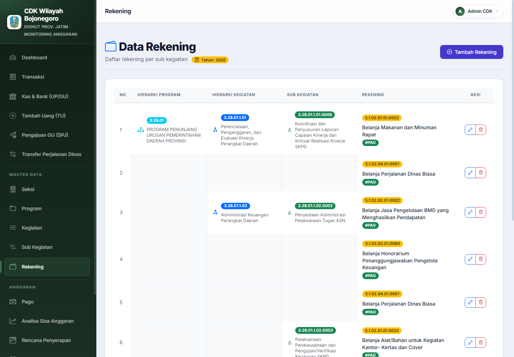

*Gambar 3.2 — Daftar rekening beserta kode dan tagar RKA.*

Aturan master data:

- Kode harus unik. Kode rekening unik dalam satu sub kegiatan.
- Data yang sudah dipakai pada pagu, RAK, atau transaksi tidak dapat dihapus. Aplikasi akan menampilkan pesan gagal menghapus karena data masih berelasi.
- Perbaiki nama/kode melalui **Edit** sebelum data dipakai lebih luas.

---

# 4. Pagu dan Riwayat Perubahan

## 4.1 Halaman pagu

Menu: **Pagu**

Filter **Tahun** lalu klik **Tampil**. Kolom yang ditampilkan:

| Kolom | Arti |
|---|---|
| APBD Awal | Nilai pagu awal sebelum perubahan |
| PAPBD | Nilai pagu saat ini |
| Selisih | Selisih antara PAPBD dan APBD Awal |
| Realisasi | Total transaksi terverifikasi |
| Sisa | Pagu saat ini dikurangi realisasi |

Gunakan pencarian untuk menemukan rekening tertentu. Daftar dapat ditampilkan 10 baris per halaman atau seluruh data.

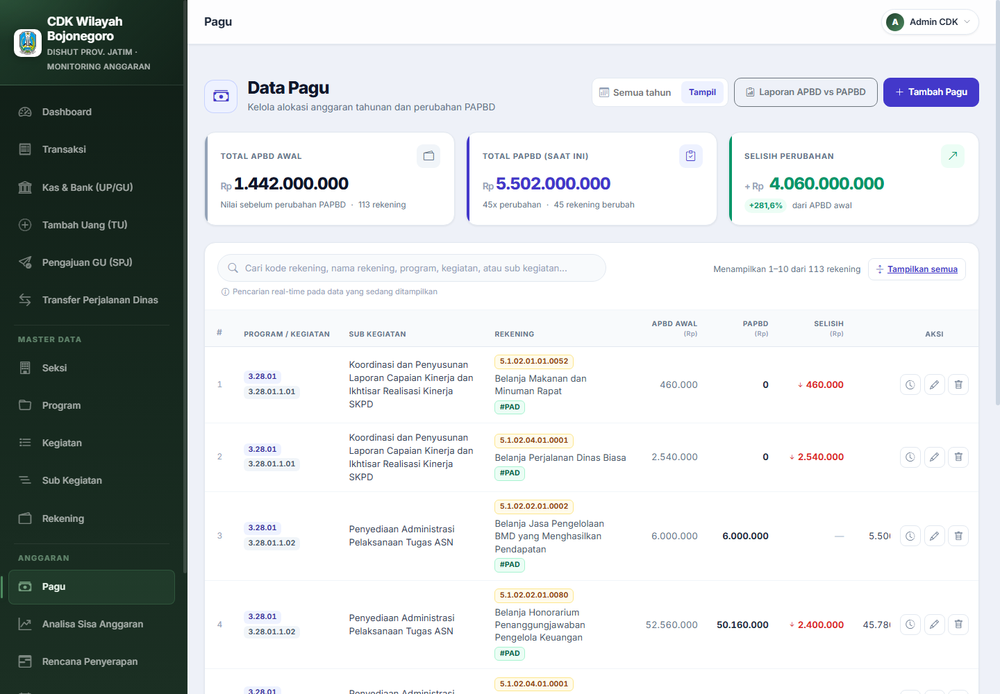

*Gambar 4.1 — Daftar pagu per rekening dengan kolom APBD Awal, PAPBD, Realisasi, dan Sisa.*

## 4.2 Input pagu satu rekening

1. Klik **Tambah Pagu**.
2. Pilih mode **Input Satu Rekening**.
3. Pilih **Program**, **Kegiatan**, **Sub Kegiatan**, dan **Rekening**.
4. Tentukan **Tahun** dan **Nilai Pagu**.
5. Klik **Simpan**.

## 4.3 Input pagu banyak rekening

1. Klik **Tambah Pagu**.
2. Pilih mode **Input Banyak Rekening**.
3. Pilih **Program**, **Kegiatan**, **Sub Kegiatan**, dan **Tahun**.
4. Isi nilai pagu pada setiap baris rekening yang dibutuhkan.
5. Klik **Simpan**.

> Input batch tidak menulis riwayat perubahan pagu. Nilai pagu yang diinput lewat batch dianggap sebagai nilai awal saat ini.

## 4.4 Mengubah pagu

1. Klik **Edit** pada rekening yang akan diubah.
2. Ubah **Nilai Pagu**.
3. Pilih **Jenis Perubahan**:
   - **PAPBD**: perubahan anggaran (pilihan utama).
   - **APBD (koreksi awal)**: koreksi terhadap nilai APBD awal.
   - **KOREKSI**: koreksi lain.
4. Isi **Keterangan Perubahan**.
5. Klik **Simpan**.

Aturan perubahan pagu:

- Pagu tidak boleh diturunkan di bawah total realisasi terverifikasi.
- Pagu dapat diturunkan di bawah total RAK, tetapi aplikasi hanya memberi peringatan. RAK harus disesuaikan secara manual.
- Riwayat hanya dicatat bila nilai atau relasi pagu berubah.

## 4.5 Laporan pagu

- **Laporan APBD vs PAPBD**: menu **Pagu → Laporan**, lalu **Export Excel**. Laporan menampilkan perbandingan pagu awal dan pagu saat ini.
- **Riwayat PAPBD**: klik **Riwayat** pada rekening untuk melihat catatan perubahan nilai beserta jenis perubahan, keterangan, dan waktu perubahan.

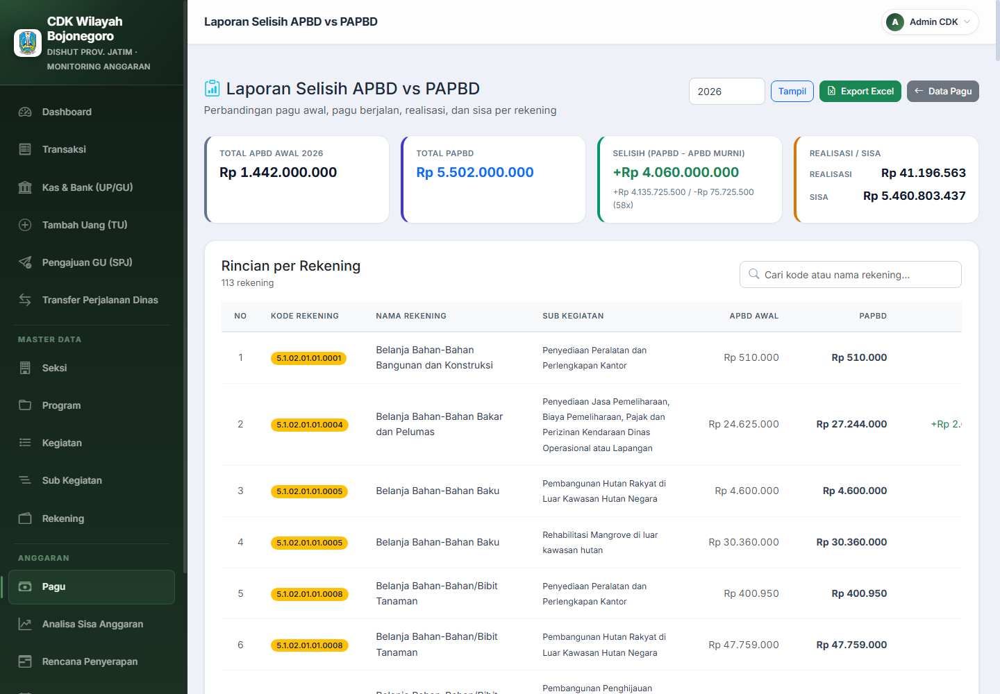

*Gambar 4.2 — Laporan APBD vs PAPBD dan riwayat perubahan pagu.*

---

# 5. Analisa Sisa Anggaran

Menu: **Analisa Sisa Anggaran**

Halaman ini dapat diakses tanpa login dan digunakan untuk mencari rekening yang masih memiliki sisa anggaran.

Langkah penggunaan:

1. Pilih **Tahun**.
2. Pilih **Seksi** bila ingin membatasi data.
3. Atur **Sisa minimal (juta)** atau gunakan preset:
   - ≥ 100 juta
   - ≥ 250 juta
   - ≥ 500 juta
   - ≥ 1 miliar
4. Pilih **Urutkan** dan isi kata kunci bila perlu.
5. Pilih **Tagar** bila ingin melihat kelompok belanja tertentu.
6. Centang **Tampilkan rekening tanpa sisa** bila ingin menampilkan rekening dengan sisa nol atau negatif.
7. Klik **Terapkan** atau **Reset** sesuai kebutuhan.

Hasil analisa:

- Kartu ringkasan menampilkan total pagu, realisasi, sisa, dan persentase serapan.
- Tabel secara default menyembunyikan rekening dengan sisa nol atau negatif.
- Grafik donut menampilkan komposisi sisa per seksi.

Ekspor:

- **Unduh Excel**: file `Analisa_Sisa_Anggaran_<tahun>.xlsx`, mengikuti filter tahun, seksi, tagar, sisa minimal, dan urutan.
- **Unduh CSV**: dibuat langsung di browser dari data yang tampil.

> Sisa pada halaman ini dihitung dari pagu dikurangi realisasi terverifikasi.

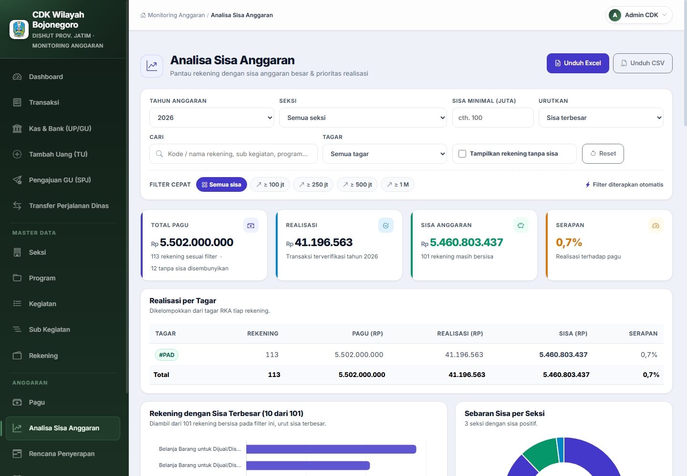

*Gambar 5.1 — Analisa Sisa Anggaran dengan filter sisa minimal dan grafik komposisi per seksi.*

---

# 6. Rencana Penyerapan

Menu: **Rencana Penyerapan** (khusus admin)

Halaman ini digunakan untuk menyusun rencana penggunaan anggaran per rekening, lengkap dengan perkiraan waktu pelaksanaan.

## 6.1 Filter dan proyeksi

1. Pilih **Tahun**.
2. Pilih **Kegiatan**, **Sub Kegiatan**, **Mekanisme** (GU/TU/LS), dan **Status** bila diperlukan.
3. Isi kata kunci untuk mencari rekening.
4. Atur **Bulan proyeksi**. Proyeksi otomatis memakai rata-rata realisasi tiga bulan sebelumnya, dengan penyesuaian untuk bulan berjalan dan bulan berikutnya.
5. Periksa kartu ringkasan: **Pagu**, **Total Rencana**, **Realisasi Terverifikasi**, dan **Sisa Kapasitas**.

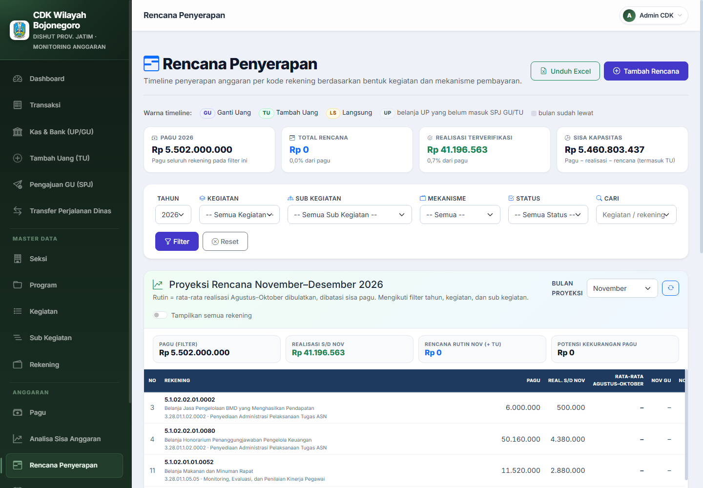

*Gambar 6.1 — Halaman Rencana Penyerapan dengan kartu rekening dan ringkasan kapasitas.*

## 6.2 Menambah rencana

1. Cari rekening yang dituju.
2. Klik **Tambah Bentuk Kegiatan** pada kartu rekening.
3. Isi:
   - **Bentuk Kegiatan** (maksimal 150 karakter)
   - **Mekanisme** (GU, TU, atau LS)
   - **Bulan Mulai** dan **Bulan Selesai**
   - **Nilai Rencana**
   - **Keterangan** (opsional, maksimal 255 karakter)
4. Klik **Simpan Rencana**.

Aturan:

- Nilai rencana harus lebih besar dari nol.
- Nilai rencana tidak boleh melebihi sisa kapasitas rekening.
- Rencana baru tidak dapat ditambahkan pada rekening yang sudah ditandai selesai.
- Rencana dapat diedit atau dihapus selama belum ditandai selesai.

## 6.3 Menandai selesai

- Klik **Tandai selesai** bila seluruh rencana pada rekening sudah selesai.
- Klik **Batal selesai** untuk membuka kembali rekening.

## 6.4 Ekspor

Klik **Unduh Excel** untuk mengunduh `Rekap_Rencana_Penyerapan_<tahun>.xlsx` dengan sheet Ringkasan, Rekap, Proyeksi, dan Detail.

> Rencana penyerapan adalah perkiraan, bukan realisasi. Realisasi tetap berasal dari transaksi terverifikasi.

---

# 7. RAK dan Rekap RAK

## 7.1 Input RAK

Menu: **RAK**

1. Klik **Tambah RAK**.
2. Pilih **Program**, **Kegiatan**, **Sub Kegiatan**, **Rekening**, dan **Tahun**.
3. Isi nilai RAK untuk 12 bulan.
4. Gunakan bantuan berikut bila perlu:
   - **Isi semua bulan** untuk mengisi nilai yang sama ke seluruh bulan.
   - **Kosongkan** untuk menghapus semua nilai.
   - Salin nilai ke bulan berikutnya.
5. Klik **Simpan**.

Aturan:

- Pagu rekening harus sudah ada sebelum RAK diinput.
- Total RAK satu tahun tidak boleh melebihi pagu rekening.
- Nilai RAK tidak boleh negatif.

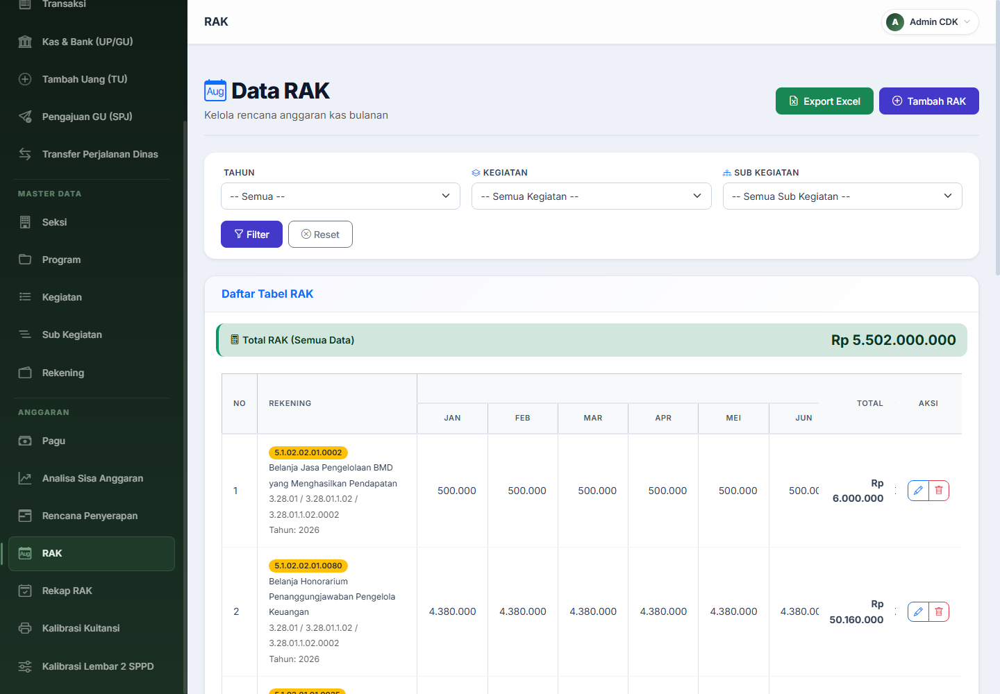

*Gambar 7.1 — Daftar RAK per rekening.*

## 7.2 Mengubah dan menghapus RAK

- Klik **Edit** untuk mengubah nilai per bulan.
- Klik **Hapus** untuk menghapus RAK rekening tersebut.

## 7.3 Rekap RAK

Menu: **Rekap RAK**

1. Pilih **Tahun**.
2. Gunakan **Expand All** atau **Collapse All** untuk membuka/menutup hierarki.
3. Rekap menampilkan hierarki Kegiatan → Sub Kegiatan → Rekening.
4. Klik **Export Excel** untuk mengunduh rekap sesuai filter.

File ekspor RAK: `RAK_<tahun>_<tanggal_waktu>.xlsx`.

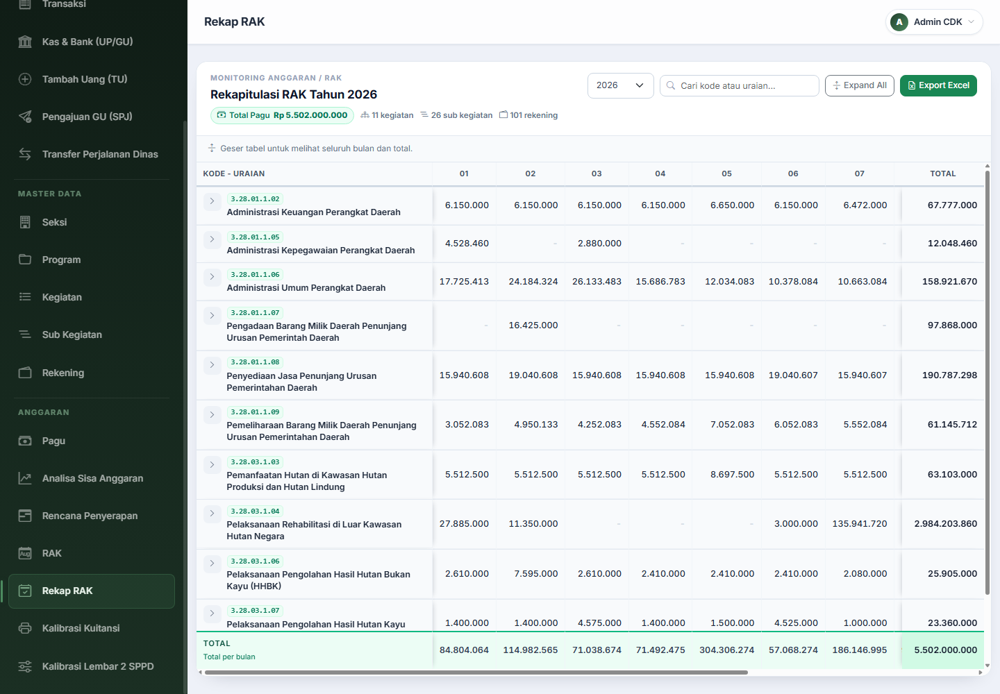

*Gambar 7.2 — Rekap RAK dengan hierarki kegiatan, sub kegiatan, dan rekening.*

> RAK adalah rencana belanja per bulan. RAK tidak mengurangi sisa anggaran pada laporan realisasi, tetapi menjadi pembanding pada dashboard dan menjadi pertimbangan pada form input admin.

---

# 8. Transaksi (Admin)

Menu: **Transaksi** (khusus admin)

Halaman ini digunakan untuk melihat seluruh transaksi, menginput transaksi batch, memverifikasi, menolak, dan mencetak dokumen.

## 8.1 Daftar transaksi

Filter yang tersedia:

- **Bulan** dan **Tahun**
- **Kegiatan**
- **Sub Kegiatan**
- **Seksi**
- **Status**
- **Rentang tanggal input**
- **Kata kunci**

Status transaksi:

| Nilai status | Label di aplikasi | Arti |
|---|---|---|
| `diajukan` | Menunggu Verifikasi | Transaksi sudah diinput dan menunggu admin |
| `diverifikasi` | Terverifikasi | Transaksi sah, sudah mendapat nomor bukti resmi |
| `ditolak` | Ditolak | Transaksi ditolak dengan catatan |

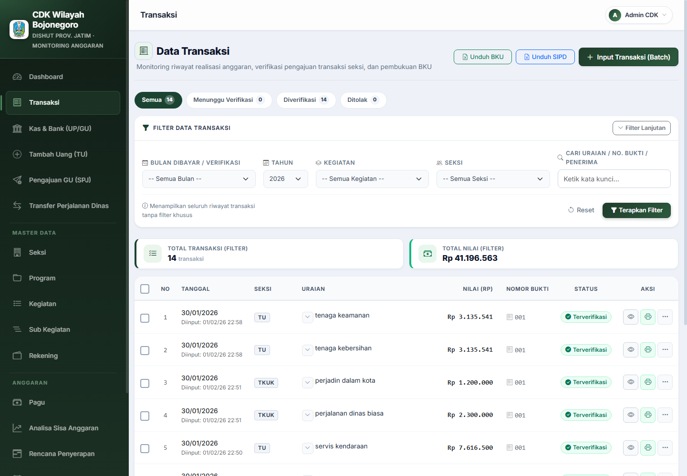

*Gambar 8.1 — Daftar transaksi admin dengan filter dan aksi per baris.*

## 8.2 Input transaksi batch

1. Klik **Input Transaksi (Batch)**.
2. Pada bagian **Klasifikasi Anggaran**, pilih **Program**, **Kegiatan**, dan **Sub Kegiatan**.
3. Pilih **Sumber Dana**: **UP** atau **LS**.
4. Pada tabel daftar rekening, isi:
   - **Rekening** (beserta sisa anggaran yang ditampilkan)
   - **Nilai**
   - **Uraian**
   - **Nomor Bukti**
5. Gunakan **Generate No. Draft** untuk membuat nomor bukti sementara, atau isi nomor secara manual.
6. Klik **Simpan Semua Transaksi**.
7. Baris dengan nilai 0 akan dilewati.

Nomor bukti:

- Nomor draft menggunakan penanda `DRAFT`.
- Nomor resmi diterbitkan otomatis saat transaksi diverifikasi, dengan format nomor urut per bulan/tahun.

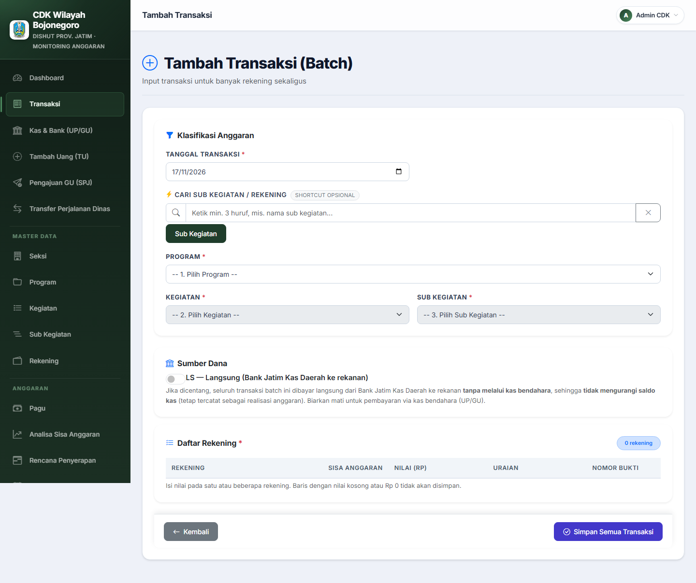

*Gambar 8.2 — Form input transaksi batch admin.*

## 8.3 Mengedit transaksi

1. Klik **Edit** pada transaksi.
2. Ubah klasifikasi atau detail transaksi:
   - Program, Kegiatan, Sub Kegiatan, Rekening
   - Uraian (maksimal 500 karakter)
   - Nilai
   - Nomor Bukti (maksimal 100 karakter)
   - Sumber dana LS
3. Bila transaksi sudah diverifikasi, **Tanggal Lunas Dibayar** dapat diubah melalui form edit atau tombol **Edit Tanggal Lunas Dibayar**.
4. Klik **Simpan Perubahan**.

> Transaksi yang sudah terverifikasi tidak dapat diedit isinya atau dihapus. Yang dapat diubah adalah tanggal lunas dibayar. Untuk mengoreksi isi transaksi, batalkan verifikasi terlebih dahulu.

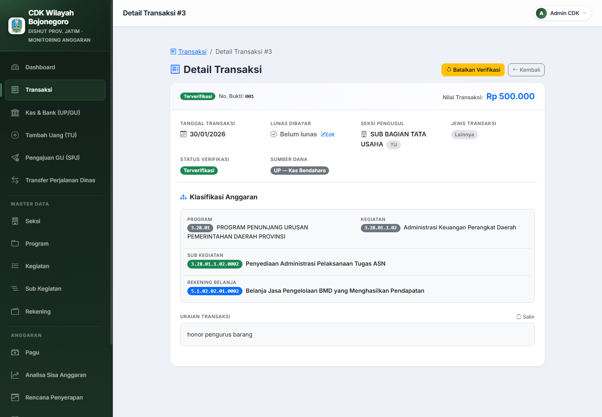

*Gambar 8.3 — Halaman detail transaksi beserta tombol cetak dan unduh.*

## 8.4 Verifikasi transaksi

### Verifikasi satu transaksi

1. Klik ikon **Verifikasi** pada baris transaksi berstatus Menunggu Verifikasi.
2. Isi **Tanggal Lunas Dibayar** (wajib).
3. Konfirmasi. Nomor bukti resmi akan diterbitkan otomatis.

### Verifikasi banyak transaksi

1. Centang beberapa transaksi.
2. Klik **Verifikasi Terpilih**.
3. Isi tanggal lunas pada modal.
4. Hanya transaksi berstatus Menunggu Verifikasi yang diproses. Transaksi lain dilewati dan jumlahnya ditampilkan pada modal.

### Menolak transaksi

1. Klik ikon **Tolak**.
2. Isi catatan penolakan (wajib).
3. Konfirmasi.

### Membatalkan verifikasi

1. Klik **Batalkan Verifikasi** pada transaksi terverifikasi.
2. Transaksi kembali ke status Menunggu Verifikasi dan memakai nomor draft.
3. Pembatalan gagal bila transaksi sudah terkait dengan pengajuan GU yang statusnya bukan lagi menunggu.

## 8.5 Aturan input transaksi admin

- Nilai transaksi harus lebih besar dari nol.
- Uraian wajib, maksimal 500 karakter.
- Nomor bukti wajib, maksimal 100 karakter.
- Sistem memblokir nilai yang melebihi sisa pagu efektif, yaitu pagu dikurangi transaksi menunggu verifikasi dan terverifikasi.
- Bila pagu belum ditetapkan, transaksi masih dapat disimpan dengan peringatan. Lengkapi pagu secepatnya.
- Pada form admin, angka **Sisa Anggaran** yang ditampilkan juga memperhitungkan RAK. Angka ini bisa lebih kecil daripada sisa validasi. Gunakan angka tampilan agar aman.

## 8.6 Cetak dan unduh dari daftar transaksi

| Dokumen | Tombol | Prasyarat |
|---|---|---|
| Kuitansi | **Cetak Kuitansi (PDF 215x165mm)** | Transaksi memiliki data yang cukup |
| SPD | **Pratinjau PDF SPD** | Jenis transaksi perjalanan dinas dan Kota Tujuan pada Surat Tugas sudah terisi |
| BKU | **Unduh BKU** | Bulan dan tahun sudah dipilih |
| SIPD | **Unduh SIPD** | Hanya transaksi terverifikasi; filter status dan kata kunci diabaikan |

> Untuk mencetak kuitansi pada blanko NCR, lakukan kalibrasi terlebih dahulu. Lihat Bab 11.

---

# 9. Transaksi Saya (Seksi)

Menu: **Transaksi Saya** (akun seksi)

Halaman ini digunakan seksi untuk mengajukan transaksi yang kemudian diverifikasi admin.

## 9.1 Daftar transaksi seksi

- Filter **Bulan**, **Tahun**, **Status**, dan **Filter Lanjutan (Diinput Pada)**.
- Status ditampilkan sebagai pill:
  - **Menunggu Verifikasi**
  - **Diverifikasi**
  - **Ditolak**
- Tombol **BKU** untuk mengunduh Buku Kas Umum seksi.
- Tombol **Edit** dan **Hapus** hanya tersedia untuk transaksi berstatus Menunggu Verifikasi atau Ditolak.
- Transaksi terverifikasi ditandai **Terkunci**.

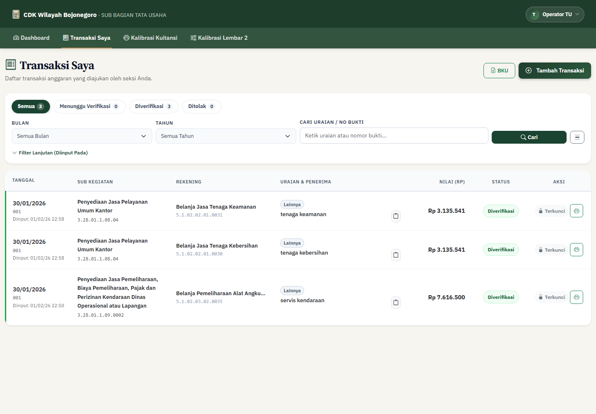

*Gambar 9.1 — Daftar Transaksi Saya milik akun seksi.*

## 9.2 Menambah transaksi

1. Klik **Tambah Transaksi**.
2. Pada bagian **1. Klasifikasi Anggaran**, pilih:
   - Program
   - Kegiatan
   - Sub Kegiatan
   - Rekening
3. Perhatikan badge **Sisa Anggaran** yang muncul.
4. Pada bagian **2. Detail Transaksi & BKU**, pilih salah satu:
   - **Ambil dari Surat Tugas** untuk transaksi perjalanan dinas.
   - **Isi manual tanpa Surat Tugas** untuk transaksi non-perjalanan dinas.
5. Isi **Tanggal Transaksi**.
6. Pilih **Jenis Transaksi**:
   - Perjalanan Dinas
   - Belanja Barang / Jasa
   - Honorarium
   - Lainnya
7. Aktifkan switch **LS** bila transaksi menggunakan pembayaran langsung.
8. Untuk perjalanan dinas, lengkapi **Rincian Transaksi per Pegawai**.
9. Periksa **Nomor Bukti** sementara. Nomor ini akan diganti nomor resmi oleh admin saat verifikasi.
10. Isi **Nama Penerima**.
11. Isi **Uraian**. Gunakan **Buat draf uraian otomatis** bila ingin membuat uraian dari data Surat Tugas.
12. Isi **Nilai**.
13. Klik **Ajukan Transaksi**.

Setelah berhasil, aplikasi menampilkan pesan bahwa transaksi diajukan dan menunggu verifikasi admin.

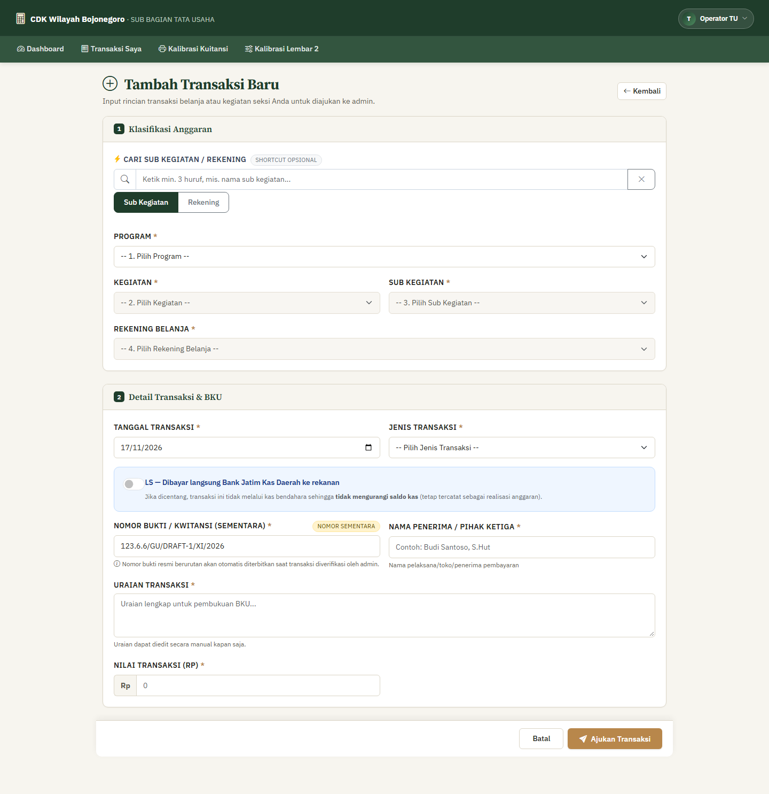

*Gambar 9.2 — Form Tambah Transaksi Baru pada akun seksi.*

## 9.3 Mengambil data dari Surat Tugas

1. Klik **Ambil dari Surat Tugas**.
2. Cari Surat Tugas pada modal **Pilih Surat Tugas & Pegawai**.
3. Centang pegawai yang ikut dalam perjalanan. Gunakan **Centang Semua** bila semua pegawai dipilih.
4. Klik **Gunakan Pilihan**.
5. Data Surat Tugas dan pegawai akan mengisi form transaksi.

## 9.4 Cek transaksi dobel

Aplikasi memeriksa apakah seorang pegawai sudah memiliki transaksi pada Surat Tugas yang sama.

- Bila terdeteksi dobel, muncul modal peringatan berisi daftar transaksi yang sudah ada.
- Transaksi tidak dikirim sampai duplikat diperbaiki.
- Untuk mengubah transaksi yang sudah ada, gunakan **Edit**, bukan membuat transaksi baru.

## 9.5 Aturan pengajuan seksi

- Transaksi perjalanan dinas wajib memiliki nomor Surat Tugas, tanggal Surat Tugas, dan tanggal pelaksanaan.
- Total nilai transaksi tidak boleh melebihi sisa pagu rekening.
- Rekening harus milik seksi pengguna.
- Satu pegawai hanya boleh memiliki satu transaksi per Surat Tugas.
- Setelah diverifikasi admin, transaksi terkunci dan tidak dapat diedit atau dihapus oleh seksi.

## 9.6 Cetak dari daftar transaksi seksi

| Dokumen | Tombol | Prasyarat |
|---|---|---|
| Rincian biaya SPPD | Ikon PDF | Rincian biaya sudah diisi |
| SPD | Ikon SPD PDF | Kota Tujuan pada Surat Tugas terisi |
| Lembar 2 SPPD | Tombol **Lembar 2** | Surat Tugas dan NIP pegawai lengkap serta Kota Tujuan terisi |
| Kuitansi | Ikon printer | Transaksi tersedia |

## 9.7 BKU seksi

1. Pilih **Bulan** dan **Tahun**.
2. Klik **BKU**.
3. Transaksi LS tidak dimasukkan ke BKU seksi.
4. Kolom saldo hanya tersedia untuk admin.

---

# 10. SPJ Perjalanan Dinas dan Lembar 2 SPPD

## 10.1 Akses modul SPJ

Modul SPJ dibuka melalui alamat `/spj`. Modul ini belum memiliki tombol di sidebar, sehingga disarankan menyimpannya sebagai bookmark.

Halaman SPJ menampilkan daftar Surat Tugas dengan filter bulan, tahun, dan kata kunci.

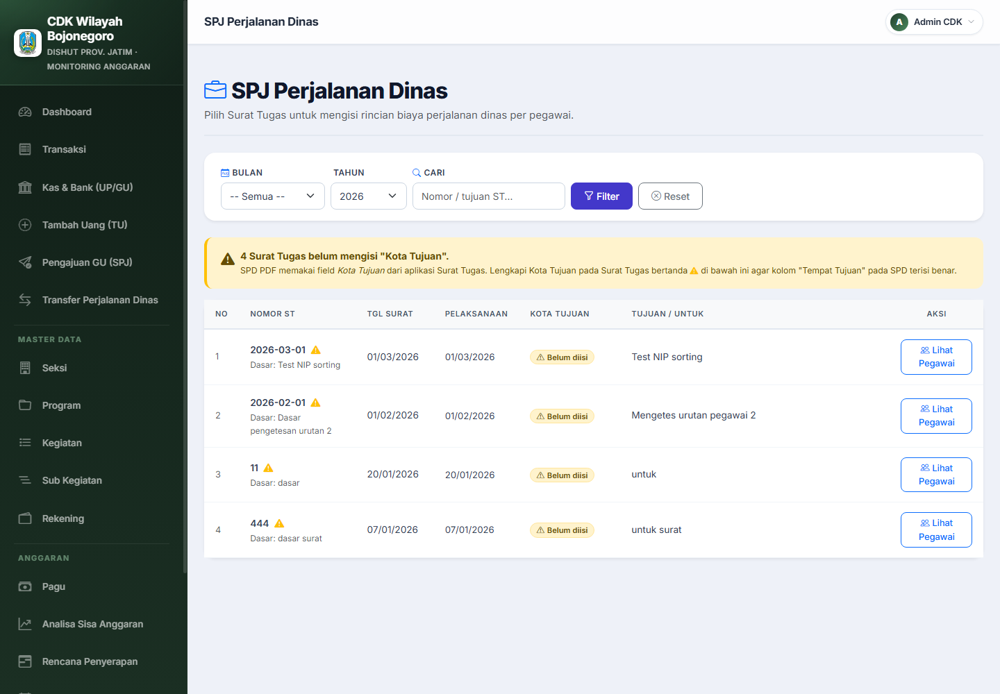

*Gambar 10.1 — Daftar Surat Tugas pada modul SPJ.*

## 10.2 Melihat pegawai dan status rincian

1. Buka modul **SPJ**.
2. Cari Surat Tugas.
3. Klik **Lihat Pegawai**.
4. Setiap pegawai menampilkan status:
   - **Sudah Diisi** bila rincian biaya sudah ada.
   - **Belum Diisi** bila rincian biaya belum ada.
5. Bila ada Surat Tugas tanpa Kota Tujuan, aplikasi menampilkan peringatan. Lengkapi Kota Tujuan pada aplikasi Surat Tugas agar SPD dan Lembar 2 dapat dicetak.

## 10.3 Mengisi rincian biaya

1. Klik **Isi Rincian** pada pegawai.
2. Isi header rincian:
   - Nilai **Ditetapkan Sejumlah**
   - Nilai **Dibayar Semula**
   - Tempat dan tanggal
3. Tambahkan komponen biaya:
   - Nama komponen
   - Harga satuan
   - Jumlah hari
   - Jumlah (dihitung otomatis)
   - Keterangan
4. Klik **Simpan**.

Aturan:

- Kombinasi Surat Tugas dan NIP pegawai harus unik.
- Bila rincian sudah ada, aplikasi mengarahkan ke halaman **Edit**.
- **Hapus** rincian hanya tersedia untuk admin.

## 10.4 Cetak SPD dan rincian biaya

- **Rincian Biaya PDF**: mencetak rincian komponen biaya.
- **SPD PDF**: mencetak Surat Perjalanan Dinas ukuran A4 portrait.
- SPD hanya dapat dicetak bila Kota Tujuan pada Surat Tugas sudah diisi.

## 10.5 Mencetak Lembar 2 SPPD

Lembar 2 SPPD dicetak sebagai overlay di atas blanko yang sudah tercetak.

1. Buka daftar **Transaksi Saya** (seksi) atau halaman **SPJ**. Tombol **Lembar 2** tersedia pada daftar transaksi seksi.
2. Klik **Lembar 2**.
3. Bagian yang terisi otomatis:
   - Bagian I: berangkat dari tempat kedudukan, kota tujuan, dan tanggal mulai.
   - Bagian II: tiba di tujuan, berangkat dari tujuan, tanggal selesai, serta jabatan/nama/NIP pejabat instansi tujuan.
   - Bagian VI: tiba kembali di Bojonegoro dan tanggal selesai.
4. Isi **Pejabat Instansi Tujuan**:
   - **Jabatan** (wajib)
   - **Nama Pejabat** (wajib)
   - **NIP** (opsional)
5. Pilih **Komponen yang Dicetak**. Gunakan **Pilih semua** bila seluruh komponen akan dicetak.
6. Klik **Cetak Lembar 2 SPPD**.
7. Cetak pada kertas A4 dengan skala 100% (Actual Size).

Bagian III, IV, V, VII, dan VIII tidak diisi oleh aplikasi karena diisi oleh pejabat saat perjalanan berlangsung.

> Jangan gunakan opsi **Fit to page** saat mencetak overlay. Posisi cetak akan bergeser.

## 10.6 Kalibrasi posisi Lembar 2

Menu admin: **Kalibrasi Lembar 2 SPPD**. Menu seksi: **Kalibrasi Lembar 2**.

1. Pilih **Printer**. Printer harus sudah dibuat terlebih dahulu pada halaman **Kalibrasi Kuitansi**.
2. Kanvas menampilkan ukuran A4 210 x 297 mm.
3. Aktifkan **Snap 1mm** bila ingin pergeseran per milimeter.
4. Unggah gambar blanko sebagai referensi.
5. Geser kotak isian atau atur nilai **X**, **Y**, **Lebar**, dan **Maks baris**.
6. Klik **Cetak Uji** untuk memeriksa posisi.
7. Klik **Simpan** bila posisi sudah sesuai.

Posisi disimpan per printer. Cetak nyata memakai printer default.

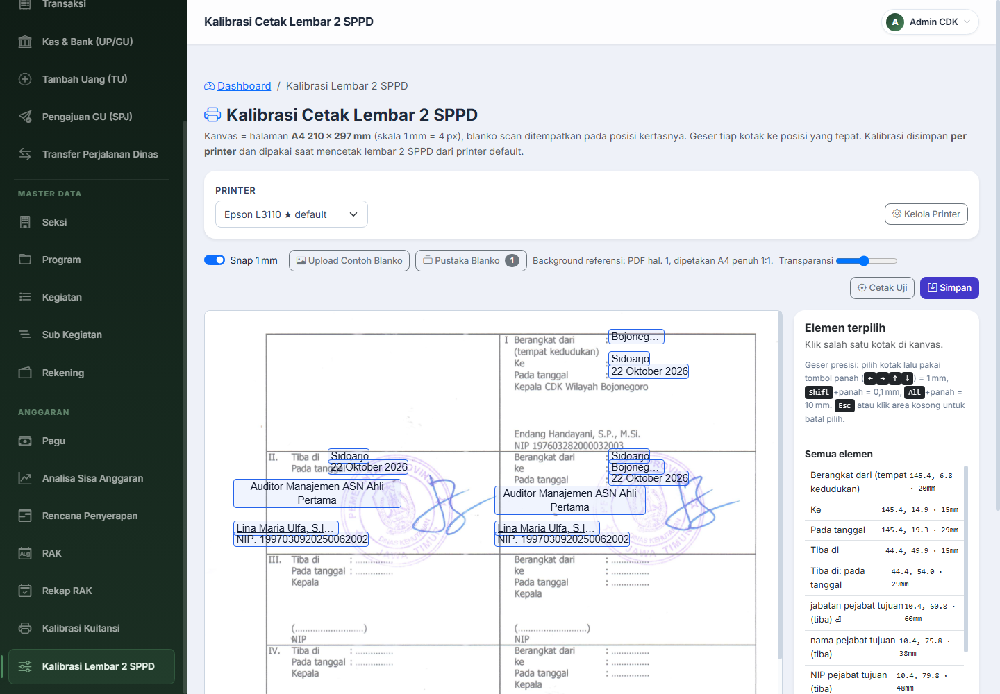

*Gambar 10.2 — Kanvas kalibrasi posisi Lembar 2 SPPD pada kertas A4.*

---

# 11. Cetak Kuitansi dan Kalibrasi

## 11.1 Mencetak kuitansi

Kuitansi dicetak dari daftar **Transaksi** (admin) atau **Transaksi Saya** (seksi).

1. Klik ikon **Cetak Kuitansi (PDF 215x165mm)**.
2. PDF terbuka di tab baru.
3. Cetak pada kertas NCR berukuran 215 x 165 mm, orientasi landscape, skala 100%.
4. Beberapa elemen sengaja dikosongkan karena sudah tercetak pada blanko, antara lain nomor BKU dan kolom "terima dari".

## 11.2 Mengelola printer

Menu: **Kalibrasi Kuitansi**

1. Pilih **Printer** yang akan dikalibrasi.
2. Klik **Tambah** untuk membuat profil printer baru.
   - **Nama Printer** wajib diisi.
   - Posisi awal disalin dari printer default.
3. Klik **Jadikan Default** untuk menjadikan printer sebagai acuan unduhan.
4. Klik **Hapus** untuk menghapus profil. Printer default tidak dapat dihapus.

## 11.3 Mengatur posisi cetak

1. Pilih **Printer**.
2. Pilih **Data contoh** yang akan ditampilkan pada pratinjau.
3. Unggah **Contoh Kuitansi** atau pilih blanko dari **Pustaka Blanko**.
   - Format gambar: JPG atau PNG, maksimal 5 MB.
   - Format PDF: maksimal 10 MB.
4. Gunakan **Potong Blanko** untuk memangkas tepi gambar.
5. Geser kotak elemen:
   - Tombol panah: pergeseran 1 mm.
   - Shift + tombol panah: pergeseran 0,1 mm.
   - Atau isi nilai **X**, **Y**, dan **Lebar** secara langsung.
6. Klik **Simpan**.
7. Klik **Cetak Uji** untuk mencetak garis dummy.
8. Buka **Petunjuk Cetak Pas** bila diperlukan.

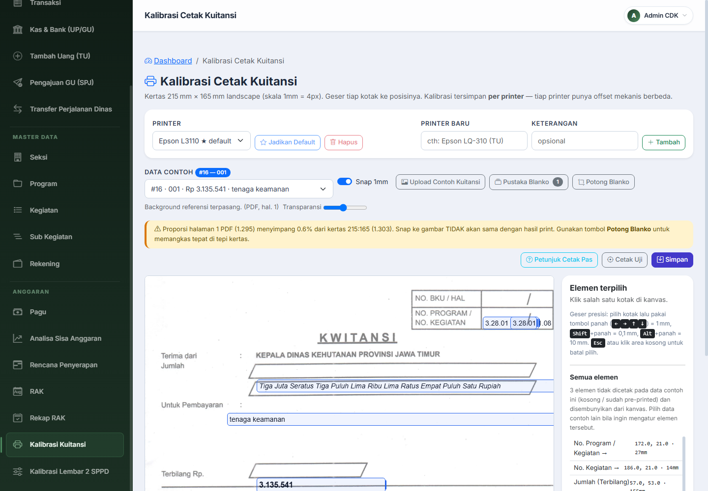

*Gambar 11.1 — Halaman kalibrasi kuitansi dengan pratinjau blanko dan kotak elemen.*

## 11.4 Pengaturan printer saat mencetak

Agar hasil tepat pada blanko:

- Skala **100%** atau **Actual Size**.
- Ukuran kertas **215 x 165 mm**, landscape.
- Margin **None**.
- Header dan footer **dimatikan**.
- Jangan memilih **Fit to page**.

## 11.5 Catatan penting

- Posisi kalibrasi disimpan terpisah untuk setiap printer. Salah memilih printer membuat hasil cetak bergeser.
- Perubahan yang belum disimpan ditandai **belum disimpan** dan akan hilang bila sesi berakhir.
- Bila sesi login berakhir saat kalibrasi, login ulang lalu ulangi penyimpanan.
- Tombol unduh kuitansi memakai printer default.

---

# 12. Kas dan Bank (UP/GU)

Menu: **Kas & Bank (UP/GU)** (khusus admin/bendahara)

Halaman ini memantau saldo kas dan bank, pencairan UP/GU, serta belanja yang belum di-SPJ-kan.

## 12.1 Menampilkan data

1. Pilih **Bulan** dan **Tahun**.
2. Klik **Tampilkan**.
3. Periksa empat kartu:
   - **Saldo Kas/Bank Riil**: dipisahkan antara uang TU dan uang GU.
   - **GU Menunggu Cair**: pengajuan GU yang belum cair.
   - **Belanja Bulan Ini (Potensi GU)**: belanja UP terverifikasi yang belum masuk pengajuan GU.
   - **Proyeksi Kas**: perkiraan saldo setelah penerimaan yang masih menunggu cair.

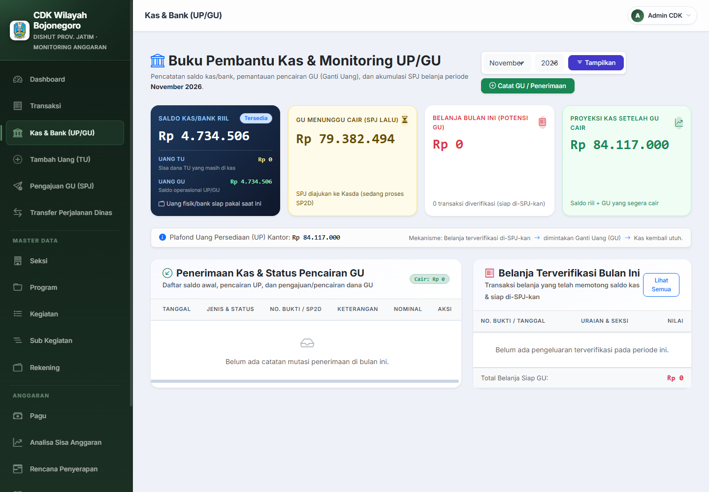

*Gambar 12.1 — Halaman Kas & Bank (UP/GU) dengan kartu saldo dan mutasi kas.*

## 12.2 Mencatat penerimaan atau mutasi kas

1. Klik **Catat GU / Penerimaan**.
2. Isi:
   - **Tanggal Pengajuan / Penerimaan**
   - **Jenis Mutasi**:
     - Pencairan GU (Ganti Uang)
     - Saldo Awal Bulan
     - Pencairan UP (Uang Persediaan)
     - Setoran Kas / Pengembalian
     - Lainnya
   - **Status Dana**:
     - **Menunggu Cair** (proses Kasda)
     - **Sudah Cair** (masuk kas/bank)
   - **Nomor Bukti / SP2D / Ref Bank**
   - **Keterangan** (wajib)
   - **Nominal** (wajib, lebih besar dari nol)
3. Klik **Simpan Mutasi Kas**.

## 12.3 Menandai pencairan

- Baris berstatus **Menunggu Cair** menampilkan tombol **Tandai Sudah Cair** atau menu **Tandai Cair**.
- Tanggal cair otomatis memakai tanggal hari ini.
- Hanya penerimaan berstatus **Sudah Cair** yang menambah saldo riil. Status Menunggu Cair hanya memengaruhi proyeksi kas.

## 12.4 Mengedit dan menghapus mutasi

- Klik **Edit** lalu **Perbarui Mutasi** untuk mengubah data.
- Klik **Hapus** untuk menghapus mutasi.

Hal yang perlu diperhatikan:

- Baris kas dari **Pengajuan GU** dan **Pengajuan TU** dibuat otomatis. Jangan menghapus baris otomatis dari halaman Kas & Bank.
- Untuk membatalkan GU yang masih menunggu, gunakan tombol **Batalkan** pada menu **Pengajuan GU**, bukan menghapus baris kas.
- Menghapus baris GU secara langsung dapat memutus tautan ke pengajuan sehingga saldo tidak bertambah saat status GU diubah menjadi cair.
- Hindari mencatat GU manual bila GU tersebut sudah dibuat melalui Pengajuan GU agar tidak terjadi pencatatan ganda.

## 12.5 Ringkasan perhitungan saldo

Saldo riil dihitung dari:

```
Saldo awal + seluruh penerimaan berstatus Sudah Cair
− belanja UP terverifikasi yang belum masuk pengajuan GU
```

Komposisi uang TU dihitung dari pencairan TU dikurangi belanja dari dana TU dan setoran sisa.

---

# 13. Pengajuan GU (SPJ)

Menu: **Pengajuan GU (SPJ)** (khusus admin)

Modul ini mengelompokkan transaksi terverifikasi menjadi pengajuan GU/SPJ.

## 13.1 Syarat transaksi yang dapat diajukan

Transaksi muncul pada daftar pengajuan bila:

- Berstatus **Terverifikasi**.
- Menggunakan sumber dana **UP**.
- Belum masuk pengajuan GU lain.
- Diinput sejak **1 Oktober 2026**.

Transaksi sebelum tanggal tersebut tidak muncul pada modul ini.

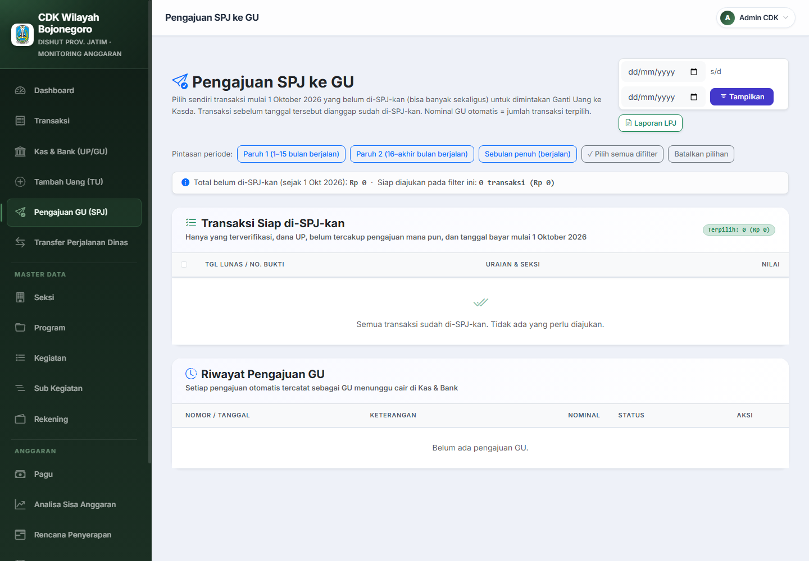

*Gambar 13.1 — Daftar transaksi yang siap diajukan sebagai SPJ/GU.*

## 13.2 Membuat pengajuan

1. Buka menu **Pengajuan GU (SPJ)**.
2. Atur filter **Dari** dan **Sampai**, atau gunakan pintasan:
   - **Paruh 1**
   - **Paruh 2**
   - **Sebulan penuh**
3. Centang transaksi yang akan diajukan, atau klik **Pilih semua difilter**.
4. Isi **Tanggal Pengajuan** dan **Keterangan**.
5. Klik **Ajukan SPJ Terpilih**.
6. Konfirmasi jumlah transaksi dan total nilai.

Setelah disimpan:

- Nomor pengajuan dibuat otomatis dengan format `SPJ-GU/MM/YYYY/NNN`.
- Nilai pengajuan adalah jumlah transaksi terpilih.
- Transaksi ditandai sudah masuk pengajuan.
- Baris Kas & Bank jenis GU berstatus Menunggu Cair dibuat otomatis.

## 13.3 Status pengajuan

| Status | Label |
|---|---|
| `diajukan` | Menunggu Cair |
| `cair` | Sudah Cair |
| `ditolak` | Ditolak |

## 13.4 Aksi pada riwayat pengajuan

- **Cair**: menandai pengajuan sudah cair dan menambah saldo kas.
- **Batalkan**: membatalkan pengajuan berstatus Menunggu Cair. Transaksi kembali siap di-SPJ-kan.
- **Lepas**: mengeluarkan satu transaksi dari pengajuan. Nominal pengajuan dan baris kas disesuaikan.
- **LPJ**: membuka laporan LPJ Limpahan UP.

Pengajuan yang sudah berstatus **Sudah Cair** tidak dapat dibatalkan atau dilepas.

## 13.5 Laporan LPJ

1. Klik **Laporan LPJ** untuk rekap periode, atau **LPJ** pada pengajuan tertentu.
2. Halaman laporan menampilkan hierarki urusan, bidang, program, kegiatan, sub kegiatan, dan rekening dengan kolom:
   - Jumlah Anggaran
   - Belanja Periode Ini
   - Akumulasi Belanja
   - Sisa Anggaran
3. Klik **Cetak** untuk mencetak.
4. Klik **Unduh Excel** untuk mengunduh `LPJ_Limpahan_UP_<nomor/periode>.xlsx`.

> Pada laporan periode, kolom **Belanja Periode Ini** hanya menghitung transaksi yang sudah ditautkan ke pengajuan, sedangkan **Akumulasi Belanja** mencakup transaksi terverifikasi sampai tanggal cutoff.

---

# 14. Pengajuan Tambah Uang (TU)

Menu: **Tambah Uang (TU)** (khusus admin/bendahara)

Modul ini mengelola siklus pengajuan tambah uang: pengajuan, pencairan SP2D, pembayaran, dan penyelesaian.

## 14.1 Daftar pengajuan

Halaman awal menampilkan:

- KPI: Menunggu Cair, Disetujui (lama), SP2D Cair, Jatuh Tempo SPJ, Selesai.
- Filter: nomor TU, tahun, bulan, status, dan seksi.
- Tombol **Unduh Excel**.
- Tombol **Input Pengajuan TU**.

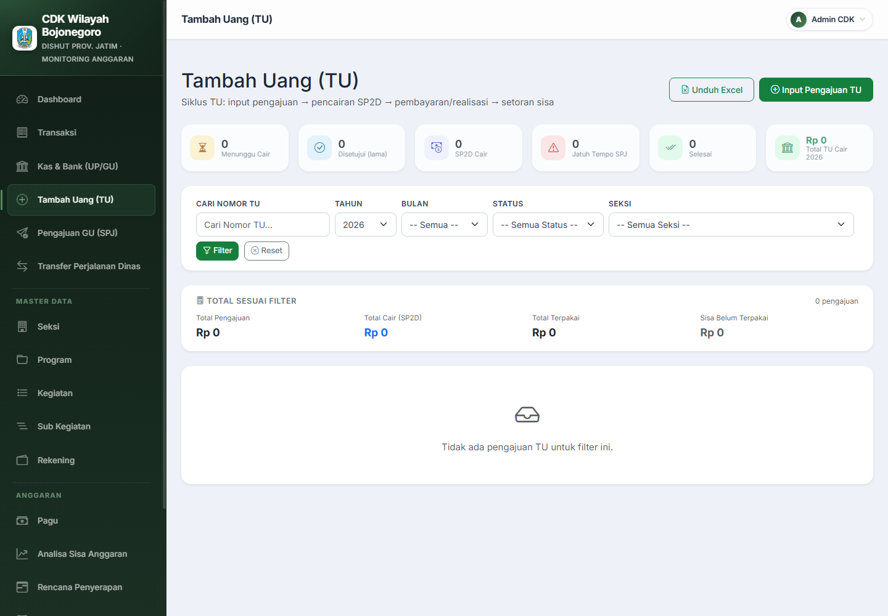

*Gambar 14.1 — Daftar pengajuan Tambah Uang (TU) beserta KPI status.*

## 14.2 Membuat pengajuan TU

1. Klik **Input Pengajuan TU**.
2. Isi:
   - **Tanggal Pengajuan**
   - **Bulan**
   - **Tahun**
   - **Keperluan**
   - Program, Kegiatan, dan Sub Kegiatan
3. Pada tabel **Rekening & Kebutuhan**, isi nominal kebutuhan untuk setiap rekening.
4. Periksa total yang dihitung otomatis.
5. Klik **Simpan Pengajuan**.

Aturan:

- Keperluan dan sub kegiatan wajib diisi.
- Minimal satu rekening harus dipilih.
- Rekening tidak boleh duplikat.
- Semua rekening harus berasal dari sub kegiatan yang dipilih.

## 14.3 Pencairan SP2D-TU

1. Buka detail pengajuan.
2. Klik **Cairkan SP2D-TU**.
3. Isi:
   - **Nomor SP2D**
   - **Tanggal Cair**
   - **Nominal Cair**
   - **Batas SPJ** (opsional, default 30 hari setelah pencairan)
4. Simpan.

Setelah dicairkan:

- Status berubah menjadi **SP2D Cair**.
- Baris Kas & Bank jenis TU dibuat otomatis.
- Batas SPJ yang lewat ditandai jatuh tempo.

## 14.4 Mencatat pembayaran

1. Buka detail pengajuan berstatus SP2D Cair.
2. Klik **Catat Pembayaran**.
3. Isi data transaksi pembayaran:
   - Tanggal
   - Jenis transaksi
   - Nomor bukti
   - Program, Kegiatan, Sub Kegiatan, Rekening
   - Uraian
   - Penerima
   - Nilai
4. Simpan.

Pembayaran langsung membuat transaksi berstatus terverifikasi dan tertaut ke pengajuan TU.

Aturan:

- Nilai pembayaran tidak boleh melebihi sisa dana TU.
- Nilai pembayaran tidak boleh melebihi sisa pagu rekening.
- Pembayaran dapat dihapus selama pengajuan masih berstatus SP2D Cair.

## 14.5 Menyelesaikan TU

1. Klik **Selesaikan TU**.
2. Isi:
   - **Nominal Setoran**
   - **Tanggal Setoran**
   - **Nomor Bukti**
3. Simpan.

Aturan:

- Setoran tidak boleh melebihi sisa dana TU.
- Setoran lebih besar dari nol dicatat sebagai mutasi kas jenis setoran.
- Setelah status menjadi **Selesai**, pembayaran tidak dapat ditambah atau dihapus.

## 14.6 Status dan penguncian

| Status | Label | Aksi yang tersedia |
|---|---|---|
| `diajukan` | Menunggu Cair | Edit, Hapus, Cairkan SP2D-TU |
| `cair` | SP2D Cair | Catat Pembayaran, Hapus Pembayaran, Selesaikan TU |
| `selesai` | Selesai | Hanya lihat |
| `ditolak` | Ditolak | Hanya lihat |

Edit dan hapus pengajuan hanya dapat dilakukan saat status masih Menunggu Cair.

## 14.7 Ekspor TU

Klik **Unduh Excel**. File mengikuti filter aktif dan berisi sheet:

- Ringkasan
- Rekap Pengajuan
- Detail Rekening
- Riwayat Pembayaran

## 14.8 Rekap STS (nilai setor)

Klik **Rekap STS** untuk mengunduh `Rekap_STS_TU_Per_Sub_Kegiatan_<tanggal>.xlsx`.

Rekap memuat TU berstatus **cair** dan **selesai**, sehingga tetap bisa diunduh setelah siklus TU ditutup. Kolom yang tersedia:

| Kolom | Arti |
|---|---|
| JML TU | Jumlah TU pada sub kegiatan tersebut |
| DANA CAIR (Rp) | Total `nominal_cair` (SP2D-TU) |
| TERPAKAI (Rp) | Belanja terverifikasi; untuk TU selesai memakai snapshot `nominal_digunakan` bila transaksinya sudah tidak ada |
| DISETOR (Rp) | Setoran yang sudah tercatat saat TU diselesaikan |
| SISA BELUM DISETOR (Rp) | Dana cair − terpakai − disetor |
| STATUS | `Cair`, `Selesai`, atau `Cair n / Selesai n` bila campuran |

> Jika belum ada TU berstatus cair maupun selesai, unduhan dihentikan dan aplikasi menampilkan pesan bahwa belum ada dana yang perlu disetor.

---

# 15. Transfer Perjalanan Dinas

Menu: **Transfer Perjalanan Dinas** (khusus admin)

Modul ini menyiapkan daftar transfer perjalanan dinas per Surat Tugas dan mengekspornya untuk bank.

## 15.1 Transaksi yang dapat dikonfigurasi

Transaksi muncul bila:

- Jenis transaksi **Perjalanan Dinas**.
- Berstatus **Terverifikasi**.
- Diinput sejak **1 Oktober 2026**.

Transaksi dikelompokkan per Surat Tugas.

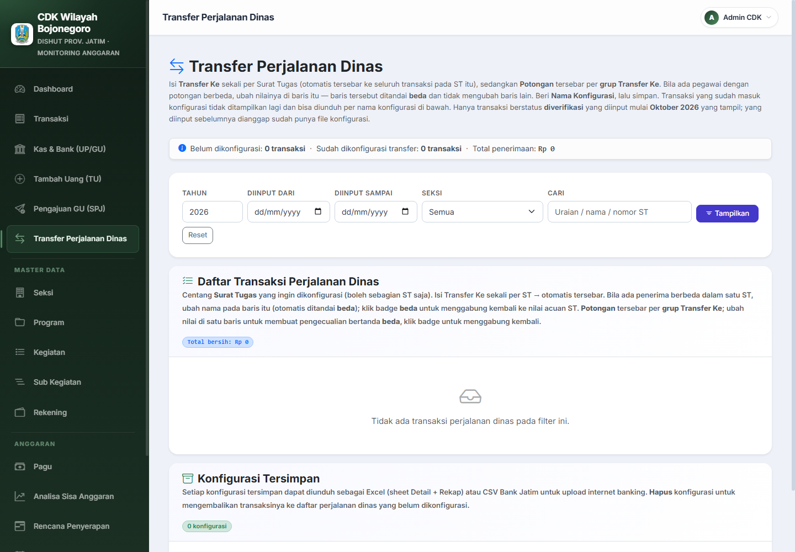

*Gambar 15.1 — Halaman Transfer Perjalanan Dinas dengan daftar ST dan kolom potongan.*

## 15.2 Membuat konfigurasi transfer

1. Buka menu **Transfer Perjalanan Dinas**.
2. Centang Surat Tugas yang akan diproses, atau klik **Pilih semua ST**.
3. Isi **Transfer Ke** sekali per Surat Tugas. Nama akan tersebar otomatis ke seluruh transaksi pada ST tersebut.
4. Isi **Potongan**. Nilai potongan tersebar per grup **Transfer Ke**.
5. Bila ada pegawai dengan nilai berbeda:
   - Ubah nilai pada baris tersebut.
   - Baris akan ditandai **beda** dan tidak mengubah baris lain.
   - Klik badge **beda** untuk menggabungkan kembali ke nilai acuan.
6. Isi **Nama Konfigurasi**. Nama wajib diisi dan harus unik.
7. Klik **Simpan Konfigurasi**.

Aturan:

- **Transfer Ke** harus berupa nama peserta Surat Tugas atau dikosongkan.
- Baris dengan Transfer Ke kosong dan potongan nol akan dihapus.
- Penerimaan Bersih = nilai transaksi − potongan.
- Transaksi yang sudah masuk konfigurasi tidak muncul lagi pada daftar konfigurasi baru.

## 15.3 Mengunduh konfigurasi

Pada bagian **Konfigurasi Tersimpan**:

### Excel

Klik **Excel** untuk mengunduh:

- Sheet **Rekap**: pivot per Transfer Ke dengan subtotal koordinator, anggota, dan Grand Total.
- Sheet **Detail**: rincian per transaksi.

### CSV Bank Jatim

Klik **CSV** untuk mengunduh file transfer format Bank Jatim.

Prasyarat:

- Rekening sumber sudah diatur pada konfigurasi aplikasi.
- Data rekening pegawai tersedia.
- Semua **Transfer Ke** terisi dan rekening penerima ditemukan.

Format CSV:

- Baris pertama: rekening sumber, total, jumlah penerima.
- Baris berikutnya: nomor rekening, nama, nominal, keterangan.

> Nominal pada CSV Bank Jatim memakai nilai bruto per penerima. Potongan tidak dikurangkan otomatis. Pastikan potongan diselesaikan sesuai prosedur keuangan.

## 15.4 Menghapus konfigurasi

Klik tombol hapus pada konfigurasi tersimpan. Transaksi akan kembali ke daftar dan dapat dikonfigurasi ulang. Berkas konfigurasi yang sudah dihapus tidak dapat diunduh lagi.

---

# 16. Ringkasan Laporan dan Ekspor

| Laporan / Berkas | Lokasi tombol | Format | Filter / Prasyarat |
|---|---|---|---|
| Laporan Realisasi Anggaran | Dashboard → Export Excel | XLSX | Tahun, bulan, grouping, seksi |
| Serapan per Sub Kegiatan per Bulan | Dashboard → Export Excel | XLSX | Tahun, seksi/program/kegiatan/sub kegiatan |
| Serapan per Triwulan | Dashboard → Export Excel | XLSX | Tahun, seksi/program/kegiatan/sub kegiatan |
| Sisa Dana per Semester | Dashboard → Export Excel | XLSX | Tahun, seksi/program/kegiatan/sub kegiatan |
| RAK | Dashboard → Export Excel atau menu RAK | XLSX | Tahun, kegiatan, sub kegiatan |
| Detail Penyerapan per Bulan | Dashboard → Export Excel | Dibuat di browser | Data yang tampil |
| Deviasi RAK | Dashboard → Export Excel | Dibuat di browser | Data yang tampil |
| Ringkasan Serapan per Unit | Dashboard → Export Excel | Dibuat di browser | Data yang tampil |
| Realisasi per Tagar | Dashboard → Export Excel | Dibuat di browser | Data yang tampil |
| Analisa Sisa Anggaran | Menu Analisa Sisa Anggaran | XLSX / CSV | Tahun, seksi, tagar, sisa minimal, urutan |
| Rencana Penyerapan | Menu Rencana Penyerapan | XLSX | Tahun dan filter aktif |
| APBD vs PAPBD | Menu Pagu → Laporan | XLSX | Tahun |
| BKU CDK | Menu Transaksi → Unduh BKU | XLSX | Bulan dan tahun |
| BKU Seksi | Menu Transaksi Saya → BKU | XLSX | Bulan dan tahun, hanya UP |
| SIPD | Menu Transaksi → Unduh SIPD | XLSX | Hanya transaksi terverifikasi |
| LPJ Limpahan UP | Menu Pengajuan GU → Laporan LPJ / LPJ | Cetak / XLSX | Periode atau pengajuan |
| Rekap Pengajuan TU | Menu Tambah Uang → Unduh Excel | XLSX | Filter aktif |
| Rekap STS TU | Menu Tambah Uang → Rekap STS | XLSX | TU berstatus cair dan selesai |
| Transfer Perjalanan Dinas | Menu Transfer Perjalanan Dinas | XLSX / CSV | Konfigurasi tersimpan |
| Kuitansi | Daftar transaksi | PDF 215 x 165 mm | Kalibrasi printer |
| SPD | Daftar transaksi / SPJ | PDF A4 | Kota Tujuan terisi |
| Lembar 2 SPPD | Daftar Transaksi Saya / SPJ | PDF overlay A4 | Surat Tugas, NIP, dan Kota Tujuan lengkap |
| Rincian Biaya | Daftar transaksi / SPJ | PDF | Rincian sudah diisi |

---

# 17. Alur Status dan Aturan Perhitungan

## 17.1 Alur status transaksi

```
Seksi mengajukan
      │
      ▼
Menunggu Verifikasi (diajukan)
      │
      ├── Admin Verifikasi ──► Terverifikasi (diverifikasi)
      │                              │
      │                              └── Admin Batalkan Verifikasi
      │                                        │
      │                                        ▼
      │                              Menunggu Verifikasi
      │
      └── Admin Tolak ──► Ditolak (ditolak)
                              │
                              └── Seksi dapat memperbaiki dan mengajukan ulang
```

Aturan:

- Hanya transaksi **Terverifikasi** yang dihitung sebagai realisasi.
- Transaksi **Menunggu Verifikasi** dan **Terverifikasi** dihitung sebagai komitmen pada validasi sisa pagu.
- Transaksi **Ditolak** tidak dihitung sebagai realisasi.
- Transaksi terverifikasi terkunci untuk seksi.

## 17.2 Alur pengajuan GU

```
Transaksi terverifikasi (UP, belum masuk GU)
      │
      ▼
Pengajuan GU dibuat ──► Menunggu Cair
      │                        │
      │                        ├── Cair ──► Sudah Cair
      │                        │
      │                        └── Batalkan ──► transaksi kembali ke daftar
      │
      └── Lepas transaksi ──► transaksi keluar dari pengajuan
```

## 17.3 Alur pengajuan TU

```
Diajukan ──► Menunggu Cair
                  │
                  ▼
            Cairkan SP2D-TU ──► SP2D Cair
                                    │
                                    ├── Catat Pembayaran (berulang)
                                    │
                                    └── Selesaikan TU ──► Selesai
```

## 17.4 Aturan perhitungan angka

| Angka | Rumus / Dasar |
|---|---|
| Total pagu | Jumlah nilai pagu pada tahun dan filter aktif |
| Total RAK | Jumlah seluruh nilai RAK pada tahun dan filter aktif |
| Komitmen | Transaksi berstatus Menunggu Verifikasi + Terverifikasi |
| Realisasi | Transaksi berstatus Terverifikasi saja |
| Bulan realisasi | Tanggal Lunas Dibayar, jika kosong memakai tanggal verifikasi, jika kosong memakai tanggal transaksi |
| Sisa anggaran | Pagu − realisasi |
| Persentase serapan | Realisasi ÷ pagu × 100% |
| Sisa kapasitas rencana | Pagu − realisasi − rencana manual − rencana TU |
| Sisa pagu validasi transaksi | Pagu − komitmen |
| Sisa anggaran pada form input admin | Pagu − RAK − komitmen (angka tampilan; validasi server memakai pagu − komitmen) |
| Penerimaan bersih transfer | Nilai transaksi − potongan |
| Saldo kas riil | Saldo awal + penerimaan Sudah Cair − belanja UP terverifikasi yang belum masuk GU |

Catatan:

- Proyeksi akhir tahun pada dashboard publik dihitung dari rata-rata bulan yang sudah memiliki data, bukan rata-rata 12 bulan.
- Sisa semester 1 yang positif dibawa ke semester 2.
- Rekening tanpa tagar dikelompokkan sebagai `#PAD` pada tab Tagar.

---

# 18. Penanganan Masalah

| Gejala | Kemungkinan penyebab | Tindakan |
|---|---|---|
| Tidak dapat login | Username/sandi salah, Caps Lock aktif, akun belum dibuat | Periksa ejaan dan Caps Lock; hubungi administrator |
| Setelah login selalu diarahkan ke Transaksi Saya | Akun memakai role seksi dan membuka halaman admin | Gunakan menu yang tersedia untuk seksi |
| Muncul pesan "Sesi login berakhir" saat kalibrasi | Sesi habis | Login ulang, buka kalibrasi, lalu simpan ulang. Posisi yang belum disimpan hilang |
| Transaksi ditolak dengan pesan melebihi sisa anggaran | Nilai melebihi pagu dikurangi komitmen | Periksa pagu, RAK, dan transaksi lain; sesuaikan nilai |
| Transaksi tidak dapat diedit atau dihapus | Status sudah terverifikasi | Minta admin membatalkan verifikasi terlebih dahulu |
| Tidak dapat menghapus master data | Data sudah dipakai pada tabel lain | Nonaktifkan penggunaan atau perbaiki relasi; hapus data turunan lebih dahulu |
| Pagu tidak dapat diturunkan | Nilai baru di bawah realisasi terverifikasi | Sesuaikan pagu atau koreksi transaksi terlebih dahulu |
| Pagu berhasil diturunkan di bawah RAK | Aplikasi hanya memberi peringatan | Sesuaikan RAK secara manual |
| Hasil cetak kuitansi bergeser | Printer salah dipilih, skala bukan 100%, atau margin tidak nol | Pilih printer yang benar, atur skala 100%, margin None, lalu kalibrasi ulang |
| Tombol SPD tidak aktif | Kota Tujuan pada Surat Tugas kosong | Lengkapi Kota Tujuan pada aplikasi Surat Tugas |
| Tombol Lembar 2 tidak aktif | Surat Tugas atau NIP pegawai belum lengkap, atau Kota Tujuan kosong | Lengkapi data Surat Tugas dan NIP |
| Upload blanko gagal | Format atau ukuran file tidak sesuai | Gunakan JPG/PNG maksimal 5 MB atau PDF maksimal 10 MB |
| Transaksi tidak muncul di Pengajuan GU | Belum terverifikasi, bukan UP, sudah masuk GU, atau diinput sebelum 1 Oktober 2026 | Periksa status, sumber dana, dan tanggal input |
| Transaksi tidak muncul di Transfer Perjalanan Dinas | Bukan perjalanan dinas, belum terverifikasi, atau diinput sebelum 1 Oktober 2026 | Periksa jenis, status, dan tanggal input |
| CSV Bank Jatim gagal dibuat | Rekening sumber atau rekening pegawai tidak ditemukan | Lengkapi data rekening pegawai dan konfigurasi rekening sumber |
| Transaksi dobel ditolak | Satu pegawai sudah memiliki transaksi pada Surat Tugas yang sama | Gunakan **Edit** pada transaksi yang sudah ada |
| Saldo kas tidak bertambah setelah GU dicairkan | Baris kas GU dihapus manual dari Kas & Bank | Gunakan **Batalkan** pada Pengajuan GU, lalu proses ulang |
| Pembayaran TU ditolak | Melebihi sisa dana TU atau sisa pagu rekening | Periksa sisa dana dan pagu rekening |
| Angka dashboard berbeda dengan daftar transaksi | Realisasi hanya menghitung transaksi terverifikasi pada bulan bayar/verifikasi | Periksa tanggal lunas, status, dan bulan filter |
| Isi ekspor tabel berbeda dengan layar | Filter belum diterapkan sebelum ekspor | Terapkan filter, tunggu halaman dimuat, lalu ekspor ulang |

---

# 19. Checklist Operasional

## 19.1 Harian — admin/bendahara

- [ ] Periksa **Antrian Verifikasi** pada dashboard.
- [ ] Verifikasi transaksi yang lengkap dan isi tanggal lunas dibayar.
- [ ] Tolak transaksi yang tidak lengkap dengan catatan yang jelas.
- [ ] Periksa transaksi yang masih Menunggu Verifikasi lebih dari satu hari.
- [ ] Periksa saldo Kas & Bank dan GU yang menunggu cair.

## 19.2 Bulanan — admin/bendahara

- [ ] Periksa dan sesuaikan RAK bulan berjalan.
- [ ] Periksa rencana penyerapan dan sisa kapasitas.
- [ ] Unduh BKU bulanan.
- [ ] Unduh laporan SIPD untuk transaksi terverifikasi.
- [ ] Buat pengajuan GU sesuai periode SPJ.
- [ ] Periksa pengajuan TU yang mendekati batas SPJ.
- [ ] Rekonsiliasi saldo kas dengan mutasi bank.
- [ ] Konfigurasi transfer perjalanan dinas dan unduh file bank bila diperlukan.

## 19.3 Harian/mingguan — seksi

- [ ] Input transaksi segera setelah kegiatan berlangsung.
- [ ] Pastikan Surat Tugas dan Kota Tujuan sudah lengkap.
- [ ] Periksa transaksi dobel sebelum mengajukan.
- [ ] Perbaiki transaksi yang ditolak dan ajukan ulang.
- [ ] Cetak kuitansi/SPD/lembar 2 bila diperlukan.
- [ ] Lengkapi rincian biaya perjalanan dinas.

## 19.4 Akhir tahun

- [ ] Pastikan seluruh transaksi sudah diverifikasi atau ditolak.
- [ ] Selesaikan seluruh pengajuan TU.
- [ ] Buat LPJ GU yang masih berjalan.
- [ ] Periksa sisa anggaran per rekening.
- [ ] Unduh dan arsipkan laporan realisasi, RAK, BKU, dan laporan pendukung.
- [ ] Pastikan tidak ada rencana penyerapan yang tertinggal tanpa status.

---

# 20. Lampiran: Peta Menu dan URL

| Menu | URL | Peran |
|---|---|---|
| Dashboard | `/` atau `/dashboard` | Admin, publik |
| Login | `/login` | Semua |
| Dashboard TU | `/dashboard/tu` | Role TU |
| Dashboard RLPM | `/dashboard/rlpm` | Role RLPM |
| Dashboard TKUK | `/dashboard/tkuk` | Role TKUK |
| Transaksi | `/transaksi` | Admin |
| Transaksi Saya | `/seksi/transaksi` | Seksi |
| Kas & Bank (UP/GU) | `/kas-bank` | Admin |
| Tambah Uang (TU) | `/pengajuan-tu` | Admin |
| Pengajuan GU (SPJ) | `/pengajuan-gu` | Admin |
| Transfer Perjalanan Dinas | `/transfer-perjadin` | Admin |
| SPJ | `/spj` | Admin, seksi (akses langsung) |
| Seksi | `/seksi` | Admin |
| Program | `/program` | Admin |
| Kegiatan | `/kegiatan` | Admin |
| Sub Kegiatan | `/sub-kegiatan` | Admin |
| Rekening | `/rekening` | Admin |
| Pagu | `/pagu` | Admin |
| Analisa Sisa Anggaran | `/analisa-sisa-anggaran` | Admin, publik |
| Rencana Penyerapan | `/rencana-penyerapan` | Admin |
| RAK | `/rak` | Admin |
| Rekap RAK | `/rak/rekap` | Admin |
| Kalibrasi Kuitansi | `/kuitansi/kalibrasi` | Admin, seksi |
| Kalibrasi Lembar 2 SPPD | `/spj/sppd2/kalibrasi` | Admin, seksi |

Alamat dasar aplikasi dapat berbeda sesuai konfigurasi server. Gunakan alamat yang diberikan administrator.

---

**Akhir dokumen**

Buku manual ini mencakup fitur utama aplikasi. Untuk perubahan alur atau penambahan fitur baru, manual perlu diperbarui agar tetap sesuai dengan aplikasi.
